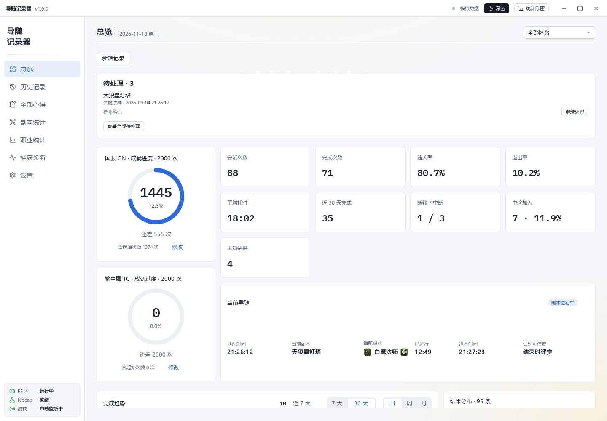
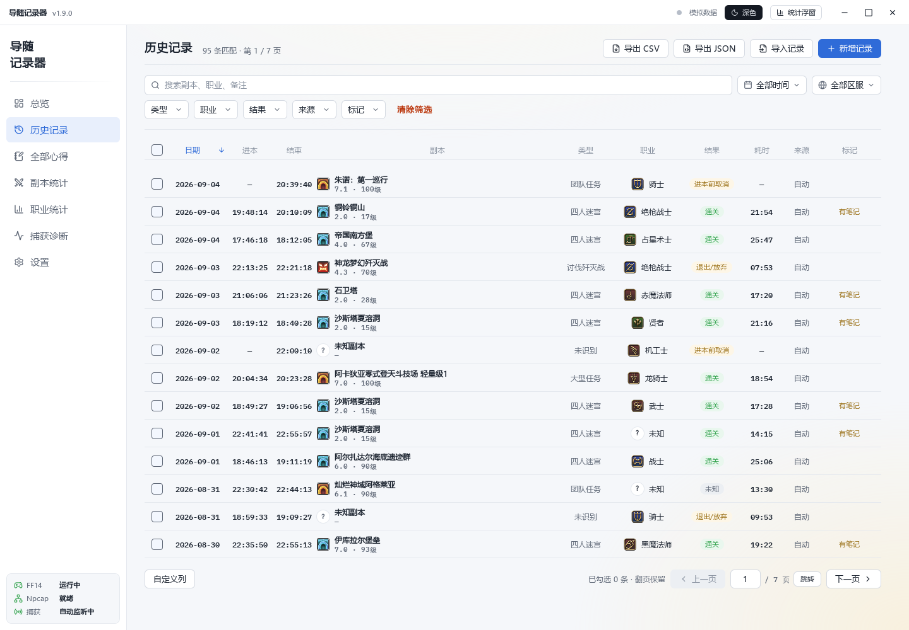
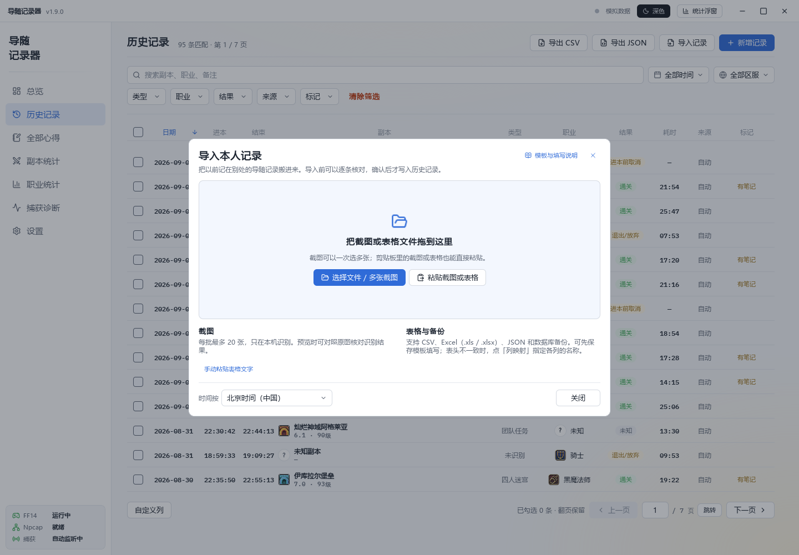

<h1 align="center">
  <br>
  Mentor Roulette Recorder
</h1>

<p align="center">A Windows desktop app that records FINAL FANTASY XIV Duty Roulette: Mentor runs</p>

<p align="center"><a href="README.md">简体中文</a> · <a href="README.zh-TW.md">繁體中文</a> · <b>English</b> · <a href="README.ja.md">日本語</a></p>

<p align="center">
  <a href="https://github.com/Harendotes-Tang/MentorRouletteRecorder/actions/workflows/ci.yml"></a>
  <a href="https://github.com/Harendotes-Tang/MentorRouletteRecorder/releases/latest"></a>
  <a href="LICENSE"></a>
  
</p>

<p align="center">
  <a href="https://github.com/Harendotes-Tang/MentorRouletteRecorder/releases/latest">Download the latest release</a> ·
  <a href="https://gitcode.com/Harendotes-Tang/MentorRouletteRecorder/releases">GitCode mirror</a> ·
  <a href="#quick-start">Quick start</a> ·
  <a href="#faq">FAQ</a>
</p>

Mentor Roulette Recorder passively reads the game traffic on this PC through Npcap. It records Duty Roulette: Mentor matches, duty entries, clears and exits, and tracks achievement progress per region and character.
You can add missed runs by hand, import older records, view duty and job statistics, and organize your notes. Records, screenshot recognition and share images all stay on this PC.

**The current source version is recorded in [Directory.Build.props](Directory.Build.props); a version there does not mean that its installer has been released.** Automatic recording and login character identification currently support the **Chinese server** and the **Global server** (Global client version 2026.11.03).
The Traditional Chinese server currently supports manually managed records only. See [CHANGELOG.md](CHANGELOG.md) (Chinese) for the full list of changes and upgrade notes.

<p align="center"></p>

## Contents

- [Features](#features)
- [Region support](#region-support)
- [System requirements and installation](#system-requirements-and-installation)
- [Quick start](#quick-start)
- [Importing history and notes](#importing-history-and-notes)
- [Offline screenshot OCR](#offline-screenshot-ocr)
- [How it works](#how-it-works)
- [Privacy and network boundaries](#privacy-and-network-boundaries)
- [FAQ](#faq)
- [Building from source](#building-from-source)
- [Contributing, security and license](#contributing-security-and-license)

## Features

- **Automatic recording and result confirmation**. Detects matches, duty entry and exit, and records a clear automatically when the duty completion result arrives. When the outcome is unclear, you can confirm it in the result pop-up or under "To do" on the Overview.
  When a duty-start or remaining-time signal is detected, the app also records whether you entered from the start or joined in progress.
- **Achievements per region and character**. Each character has its own goal, starting count and progress. Add or manage characters in "Settings → Achievement"; history can be filtered by character, and the character a run belongs to can be changed in bulk.
  On the Chinese and Global servers the logged-in character is identified by default, and bound characters are switched automatically. On the Traditional Chinese server you switch characters manually on the Overview.
- **History and statistics**. Date presets and region and character filters help you find records. The share donuts in duty and job statistics are clickable, and categories that support filtering open the matching history.
  The completion trend can be viewed by day, week or month. The Mentor stats overlay supports custom modules, a mini bar and mouse click-through.
- **Manual entries, corrections and export**. Manual entries and corrections can store images and notes and keep a revision history; soft-deleted records can be restored within the retention period.
  CSV and JSON exports follow the current sort order of the history list. The database is backed up automatically every day by default, and you can also back it up manually.
- **Import and offline recognition**. Supports spreadsheets, native JSON, database backups made by this app, pasted content and dlog screenshots. You preview and confirm first, then save the selected records.
- **All notes and share images**. Search note text, filter by date and switch the sort order. When sharing, sort by date or reorder by dragging, and save one long image or one PNG per entry.
- **Languages, speech and tray**. Supports 简体中文, 繁體中文, English and 日本語. You can switch the interface language and the system voice, and turn on optional online speech.
  With "Launch at startup" enabled, the app starts in the system tray; open the main window to read the update notes.
- **Capture diagnostics and evidence collection**. Automatically finds the network adapter that carries game traffic; you can run detection again or view the diagnostic report. Evidence collection for new regions and for character identification each have their own wizard.
  After a Chinese client update, recording can be restored through local or shared calibration.

<details>
<summary>History and import pages</summary>

<p align="center"></p>
<p align="center"></p>

</details>

## Region support

| Game region | Automatic recording | Records, import and achievements |
|---|---|---|
| Chinese server `CN` | Ships with the verified `2026.08.05` protocol profile. Later versions require local or shared calibration | Manual entries, import and export, and per-character statistics. Login character identification can be turned off in Settings |
| Traditional Chinese server `TC` | Awaiting a verified protocol profile | Has its own Traditional Chinese duty and roulette catalogs; supports manual entries, import and export, and manual character switching |
| Global server `GLOBAL` | Ships with the verified `2026.11.03` protocol profile. Later versions need a new profile released with an app update | Manual entries, import and export, and per-character statistics. Login character identification can be turned off in Settings |

The game region determines which records a run belongs to; the interface language can be switched independently. To help verify automatic recording, collect evidence by following the guide for your region.
See the [Traditional Chinese server testing guide](docs/traditional-chinese-server-testing.md) (Traditional Chinese), the [Global server testing guide](docs/global-server-testing.md) and the [protocol profiles](protocol-profiles/README.md) (Chinese).

## System requirements and installation

| Item | Requirement |
|---|---|
| Operating system | Windows 10 64-bit version 1809 (build 17763) or later, or Windows 11. Windows 11 on ARM can run it under x64 emulation; packet capture there has not been verified |
| Automatic recording | The Chinese client and [Npcap](https://npcap.com/) with *WinPcap API-compatible Mode* enabled |
| Speech | Windows N editions need the Media Feature Pack |
| Runtimes | The installer and the ZIP include the .NET, Qt and offline OCR runtimes |

1. Download `MentorRecorder-<version>-setup.exe` from the [latest GitHub release](https://github.com/Harendotes-Tang/MentorRouletteRecorder/releases/latest).
   The installer is also available from the [GitCode mirror](https://gitcode.com/Harendotes-Tang/MentorRouletteRecorder/releases).
   GitHub also provides a portable `win-x64.zip` that runs after extraction. Older versions and test builds tagged `-beta.N` are on [GitHub Releases](https://github.com/Harendotes-Tang/MentorRouletteRecorder/releases).
2. You can check the download against the `.sha256` file on the release page with `Get-FileHash -Algorithm SHA256 -LiteralPath '<path-to-downloaded-file>'`, then run the installer.
   The wizard preselects the option that matches your Windows display language. The first launch uses the language chosen during installation; upgrades from an older version keep the existing setting.
3. The installer suggests `D:\MentorRecorder` first, and `Program Files\MentorRecorder` when drive D does not qualify. You can choose an empty folder, or the existing installation directory when upgrading.
   The installed files are managed by administrators; the note image directory `note-images` is writable by standard users.
4. The free edition of Npcap is distributed through the Npcap website. If the driver is missing, the installer downloads and verifies the official Npcap installer. Keep its default options, especially *WinPcap API-compatible Mode*.

**Upgrading from an older version.** 1.9.0 upgrades the database to schema 15, and 1.9.1 upgrades it to schema 17. Keep a database backup before upgrading; to roll back to an older version, use the backup made before the upgrade.
Manual entries and imported records without a region from 1.8.0 and earlier are assigned to the Chinese server. Goals, starting counts and records that already have a region move into that region's existing profile.
Database backups and record exports do not include note images; save `note-images` separately.

## Quick start

1. **Enter the starting count.** On first use, enter the number of completions from before installation, as shown in the in-game achievement panel. If the app already has records that count toward progress, first subtract those clears from the panel's count.
   Progress equals the character's starting count plus the recorded clears that count toward progress.
2. **Start the recorder first, then log in to the game.** If you are already logged in, return to the title screen and log in again. On the Chinese server the connection has to be tracked from the moment it is established, and teleporting in the game does not re-establish it.
3. **Manage which character a run belongs to.** When there is only one profile and no character has been registered yet, the first character identified on the Chinese server is bound automatically.
   When "A character that isn't registered yet" appears, you can link it to an existing profile, register a new character, or choose "Don't track this character". Pending records move to the chosen profile once the character is bound.
   To manage characters manually, first add them in "Settings → Achievement", and select the current character on the Overview before you log in with a different character.
4. **Take part in Duty Roulette: Mentor.** When the clear result arrives, the app counts the clear automatically. If no result arrives before you leave, you can confirm the outcome in the separate pop-up, the overlay prompt or "To do" on the Overview.
5. **Organize older records.** Import your own past records in "History → Import records". You can filter and correct records, and create share images in "All notes".

For problems or feature requests, click "Feedback" on the left side of the main window. "Give feedback on GitHub" opens the [GitHub issue templates](https://github.com/Harendotes-Tang/MentorRouletteRecorder/issues/new/choose).
"Write an email" opens a draft addressed to `mentorrecorder@gmail.com` in your default email app; you can also copy the address and send the message yourself.

## Importing history and notes

In "History → Import records", choose or drag in files, or paste spreadsheets and screenshots from the clipboard.

| Source | Supported |
|---|---|
| Spreadsheets | CSV, Excel `.xls` / `.xlsx`, and pasted table text; if the headers differ, you can map the columns. The template includes a region (区服) column |
| This app's records | Native JSON exported by this app, and SQLite database backups. Import parses the source and builds a preview; the existing database is never overwritten |
| Screenshots | dlog mobile cards and web record lists in PNG, JPG / JPEG, WebP or BMP, up to 20 images per batch |

1. Check the region, duty, job, date, result and notes against the original file or image, and choose the time zone that fits the source. Sources without a completion result may be prefilled as "Cleared"; choose the actual result.
2. Tick the entries to save and confirm that they are your own records. Items marked "Possible duplicate" must be checked one by one. Confirmed duplicates are skipped, and conflicts keep the local record.
3. When there are clears that count toward progress and the current profile's starting count is greater than zero, answer according to the facts whether these clears are already included in the starting count. Choosing "Already included" deducts the number of
   valid clears actually added from the starting count, down to a minimum of zero. Database backups and JSON exported by this app default to "Not included"; spreadsheets, the clipboard, screenshots and other JSON default to "Already included".
4. After confirming the import, check the saved results. When the actual entry and exit times are missing, they stay unknown, and the date from the original site is still used for sorting, date filters and trends.
   Mentor roulette clears confirmed as your own can count toward the achievement; unknown entry and exit times and durations can be filled in later.

Note sharing saves PNG files in the chosen order and reports the result for each file. The generated files stay on this PC, and sharing them is up to you.

## Offline screenshot OCR

The package ships CPU text recognition and a small job icon classifier. You do not need to install Python or configure a GPU. The app uses RapidOCR 3.10.0 and ONNX Runtime 1.32.0
to recognize text and its coordinates on this PC, then builds a preview from the table layout and the job icons. Low-resolution images, unfamiliar layouts, symbols and job candidates need manual review.


A development regression on 2026-10-10 compared the two recognition approaches on 5 web screenshots containing 50 records in total. The RapidOCR approach output 50 records; 48 raw duty names matched character for character,
and 50 matched with help from the duty catalog. A separate round focused on punctuation, plus regression, covered 7 screenshots and 70 records. Neither round measured full-text accuracy for notes, and neither was used for cross-machine acceptance.
For the full counts and the limits of the samples, see the [comparison report](docs/ocr-test-comparison-20261010.json) and the [punctuation validation report](docs/ocr-punctuation-test-20261010.json).

Model versions, sources and licenses are listed in the [OCR dependency manifest](docs/licenses/ocr/dependency-manifest.json) and the
[job classifier metadata](src/Desktop/resources/models/job-icon-classifier.metadata.json). You can open the [interactive architecture diagram](docs/ocr/local-ocr.html) (Chinese) locally.

## How it works

| Process | Responsibility |
|---|---|
| `MentorRecorder.Collector.exe` | C# / .NET 8. Captures, decodes and recognizes events through Machina.FFXIV and Npcap, and manages the SQLite records and the local named pipe |
| `MentorRecorder.Desktop.exe` | C++20 / Qt Quick. Provides the main window and the overlay, starts and monitors the Collector, and reads state or submits edits over the local named pipe |
| `local-ai-ocr.exe` | Starts only when screenshots are imported; outputs text coordinates on this PC and exits |

Protocol profiles describe the match, zone change, area and job messages for each client version. On the Chinese server, the clear result and the start and remaining-time signals are recognized by message content.
When no profile matches, automatic recording pauses until a suitable calibration has been obtained and confirmed. Real-machine evidence covers the Chinese server's recording chain from the match to leaving the duty;
the clear result was tested on one duty under client version `2026.09.15`. Real-machine evidence is still needed for clear results in other duties and for joining in progress.
See [architecture](docs/architecture.md) (Chinese), [state machine](docs/state-machine.md) (Chinese) and [protocol profile format](docs/protocol-profile-format.md) (Chinese).

## Privacy and network boundaries

- Capture is passive, through Npcap: no injection, no reading of game process memory, no telemetry and no account. The capture path sends no packets to the game and does not keep raw packets long term.
  To decompress traffic, the Collector loads a temporary copy of the game executable into its own process and cleans it up when listening stops. A copy that is still in use is registered and handled at the next start.
- During a new-region evidence round, if the current game version has no ready decompression support, the Collector reads the game executable file on this PC to look for the relevant locations, and writes what it found and the file's checksum to the local log; if the search is incomplete, or nothing can be decoded with what it found, the log also records a few short excerpts of the game executable's instruction bytes. The log contains no packets and no personal information, stays on this PC, and the tester decides whether to send it to the maintainer; see sections 4 and 5 of the [privacy and network boundary document](docs/privacy-boundary.md) (Chinese).
- Chinese server character identification computes a digest of the character identifier in the login message with a key kept on this PC. Character names are entered by the user; the app never reads character names from the game. Neither record exports nor diagnostic reports contain identity digests.
- Records, source files, OCR text, notes and images are processed on this PC; the desktop app and the Collector communicate over a local named pipe.

| Network feature | Default and behavior |
|---|---|
| Shared calibration | On by default. Reads public calibrations on demand from a fixed GitHub repository, falling back to a fixed GitCode mirror. A calibration is used for recording only after it passes verification on this PC |
| Online speech | Off by default. Available only after you enter a key for Azure or an OpenAI-compatible service. Only the text currently being announced is sent; the key is stored on this PC, encrypted by Windows |
| Update check and download | Checking is on by default. GitHub is queried first, then GitCode if that fails. The matching installer is downloaded and its SHA-256 checked only after you click "Download installer" (if the GitHub download is too slow, you are asked whether to switch to GitCode), and it is started only after you click "Install now" |
| Installing Npcap | The installer downloads and verifies the official Npcap installer only if it finds the driver missing while this app is being installed |

You can turn off the first three in Settings, or set `MR_DISABLE_SHARED_FETCH`, `MR_DISABLE_ONLINE_SPEECH` and `MR_DISABLE_UPDATE_CHECK` to `1` and restart.
For the scope of outbound requests, the contents of diagnostic exports and how to check for yourself, see the [privacy and network boundary document](docs/privacy-boundary.md) (Chinese).

## FAQ

**How do I restore automatic recording after a game update?**
Follow the prompt in the main window, complete one roulette as usual, and review the local calibration result. When a shared calibration is available, the app decides when to enable it based on verification against the traffic on this PC.
If the protocol has changed or you want to help with support, collect evidence by following the [live validation guide](docs/live-validation-guide.md) (Chinese).

**The game is running. Why are no records being created?**
First check region support and the protocol status. If the Chinese client is already logged in, return to the title screen and log in again. If you use a game accelerator or a VPN, click "Check adapters again" in "Capture diagnostics"
to see which network adapter carries the game connection and why nothing is currently being recorded. For more checks, see [capture diagnostics](docs/capture-diagnostics.md) (Chinese).

**Do I need to run it as administrator all the time?**
Elevated permissions are usually needed only for installation or updates. If Npcap was installed with access restricted to administrators, either run with elevated permissions or reinstall Npcap without that restriction.

**Where are records and attachments stored?**
Distribution builds use `%LOCALAPPDATA%\MentorRecorder\mentor_recorder.db` by default, with daily backups in `backups\`, keeping the latest 14.
You can change the data directory with `MR_DATA_DIR`. Note images are stored in `note-images\` in the program directory and can be relocated with `MR_NOTE_IMAGE_DIR`.
Uninstalling keeps data by default, and attached note images are always kept.

**I want to help collect evidence for the Traditional Chinese or Global server. Where do I start?**
Open "New region capture" in "Capture diagnostics → Tools", then follow the wizard to choose the region and network adapter, complete one roulette and save a description. Please submit the evidence privately as described in the guide.
Character identification problems on the Chinese or Global server can be checked separately with "Character identification capture"; that wizard does not add any official records.

## Building from source

The verified Windows x64 toolchain uses .NET SDK 9.0.316 (the Collector targets .NET 8), Qt 6.11.2, MinGW-w64 GCC 13.1,
CMake 3.24 or later, Ninja, PowerShell 7 and Python 3.12. Full verification requires the Python dependencies in `tools/requirements-ci.txt`
and the cppcheck version the repository requires. The installer is built with Inno Setup 6.7 or later.

```powershell
python -m pip install -r tools/requirements-ci.txt
pwsh -NoProfile -File scripts/bootstrap.ps1
pwsh -NoProfile -File scripts/verify.ps1 -Configuration Release
pwsh -NoProfile -File scripts/package.ps1 -Configuration Release -Verify
```

Toolchain paths can be overridden with `MR_QT_PREFIX`, `MR_MINGW_BIN`, `MR_CMAKE_EXE`, `MR_NINJA_EXE`, `MR_CTEST_EXE` and `MR_CPPCHECK_EXE`.
Packaging uses `build-distribution\` by default; point `MR_BUILD_DIR` at another separate directory to change it. A release also requires preparing and verifying the pinned offline OCR runtime directory and license files,
either with `scripts/bootstrap-ocr.ps1 -RuntimeDirectory <runtime-directory>` or by pointing `MR_OCR_DIR` at a verified directory.
For the full steps, see [build and packaging](docs/build-and-package.md) (Chinese), [security and quality gates](docs/security-quality-gates.md) (Chinese) and the [release checklist](docs/release-checklist.md) (Chinese).

`verify.ps1 -TestFilter 'Category!=Soak'` is used for everyday regression testing. Formal releases run full verification and a run from the unpacked package; real installs and upgrades, in-game capture and cross-machine behavior must be verified separately.

| Path | Contents |
|---|---|
| `src/Collector/` | Capture, protocol, state machine, storage, IPC, import, export |
| `src/Desktop/` | Qt Quick interface, record and profile operations, offline OCR, note sharing |
| `contracts/`, `protocol-profiles/` | IPC contracts, per-region protocol profiles and synthetic test profiles |
| `data/`, `migrations/` | Duty, job and roulette catalogs, translated names, and SQLite migrations |
| `installer/`, `scripts/` | Installer, development toolchain, test and release scripts |
| `tests/`, `tools/`, `docs/` | Tests and samples, development tools, specifications and acceptance documents |

## Contributing, security and license

- See [CONTRIBUTING.md](CONTRIBUTING.md) (Chinese) for how to submit bug reports, suggestions and pull requests. Please include reviewable evidence with changes to protocol profiles.
- Please report security issues privately as described in [SECURITY.md](SECURITY.md) (Chinese).
- This project is licensed under [GPL-3.0-or-later](LICENSE). The build links Machina.FFXIV and Qt Graphs, and distribution must comply with the corresponding GPL terms.
  Third-party components and their licenses are listed in [THIRD_PARTY_NOTICES.md](THIRD_PARTY_NOTICES.md) (Chinese).

### Acknowledgements

- Thanks to 辛弥山@龙巢神殿 for taking part in the project.
- Thanks to シーヴ for helping with evidence collection on the Global server.
- [Machina.FFXIV](https://github.com/ravahn/machina) provides traffic capture and decoding, [Npcap](https://npcap.com/) provides the capture driver,
  [Qt](https://www.qt.io/) provides the desktop UI framework, and [Lucide](https://lucide.dev/) provides the action icons.
- SQUARE ENIX job, role and duty icons and in-game translated names are used for non-commercial distribution under the
  [FINAL FANTASY XIV Materials Usage License](https://support.na.square-enix.com/rule.php?id=5382&tag=authc).
  For their sources and how to replace them locally, see the [game icon license note](src/Desktop/resources/icons/LICENSE-NOTE.md) (Chinese).

### Disclaimer

FINAL FANTASY XIV is a trademark of SQUARE ENIX CO., LTD. This project is developed independently and is not authorized, endorsed or sponsored by SQUARE ENIX.
Packet capture reads the network traffic on this PC. Make sure your environment permits this, and judge the risk to your account for yourself.
