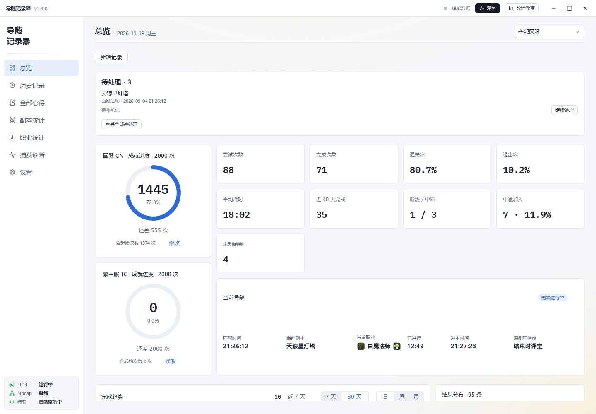
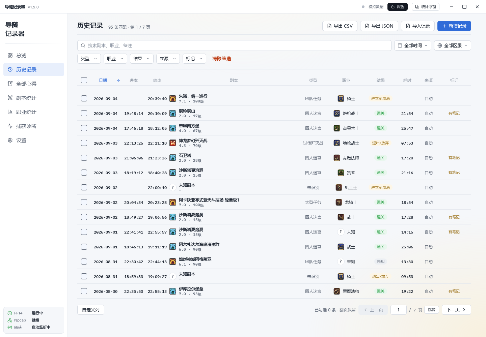
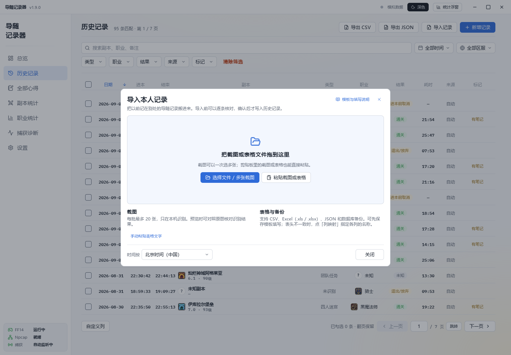

<h1 align="center">
  <br>
  メンターレコーダー
</h1>

<p align="center">『ファイナルファンタジーXIV』のコンテンツルーレット：メンターを記録する Windows デスクトップアプリ</p>

<p align="center"><a href="README.md">简体中文</a> · <a href="README.zh-TW.md">繁體中文</a> · <a href="README.en.md">English</a> · <b>日本語</b></p>

<p align="center">
  <a href="https://github.com/Harendotes-Tang/MentorRouletteRecorder/actions/workflows/ci.yml"></a>
  <a href="https://github.com/Harendotes-Tang/MentorRouletteRecorder/releases/latest"></a>
  <a href="LICENSE"></a>
  
</p>

<p align="center">
  <a href="https://github.com/Harendotes-Tang/MentorRouletteRecorder/releases/latest">正式版のダウンロード</a> ·
  <a href="https://gitcode.com/Harendotes-Tang/MentorRouletteRecorder/releases">GitCode ミラー</a> ·
  <a href="#クイックスタート">クイックスタート</a> ·
  <a href="#よくある質問">よくある質問</a>
</p>

メンターレコーダーは Npcap を使ってこの PC のゲーム通信を受動的に読み取り、コンテンツルーレット：メンターのマッチング、突入、クリア、退出を記録して、サーバーとキャラクターごとにアチーブメントの進捗を追跡します。
記録の手動追加、過去の記録のインポート、コンテンツ別・ジョブ別の統計、感想の整理にも対応しています。記録、スクリーンショットの読み取り結果、共有用画像はすべてこの PC に保存されます。

**現在のソースのバージョンは [Directory.Build.props](Directory.Build.props) に記載されています（ソースのバージョンは、そのバージョンのインストーラーが公開済みであることを意味しません）。** 自動記録とログインキャラクターの識別は、現在**中国版**と**グローバル版**（グローバル版クライアント 2026.11.03）に対応しています。
繁体字中国語版では、現在は記録を手動で管理します。すべての変更点とアップグレード時の注意事項は [CHANGELOG.md](CHANGELOG.md)（中国語）を参照してください。

<p align="center"></p>

## 目次

- [機能](#機能)
- [対応サーバー](#対応サーバー)
- [動作環境とインストール](#動作環境とインストール)
- [クイックスタート](#クイックスタート)
- [過去の記録と感想のインポート](#過去の記録と感想のインポート)
- [オフラインのスクリーンショット OCR](#オフラインのスクリーンショット-ocr)
- [仕組み](#仕組み)
- [プライバシーとネットワークの境界](#プライバシーとネットワークの境界)
- [よくある質問](#よくある質問)
- [ソースからのビルド](#ソースからのビルド)
- [コントリビューション、セキュリティ、ライセンス](#コントリビューションセキュリティライセンス)

## 機能

- **自動記録と結果の確認**。マッチング、突入、退出を識別し、コンテンツの結果を受信すると自動的にクリアとして記録します。結果が不明な場合は、結果ウィンドウまたは概要の「要対応」で確認できます。
  コンテンツ開始または残り時間のシグナルを識別した場合は、開始から参加したか途中参加したかも記録します。
- **サーバーとキャラクターごとのアチーブメント**。キャラクターごとに目標、記録開始前の回数、進捗を個別に持ちます。「設定 → アチーブメント」でキャラクターを追加・管理でき、履歴はキャラクターで絞り込んだり、割り当て先をまとめて変更したりできます。
  中国版とグローバル版では既定でログインキャラクターを識別し、紐付け済みのキャラクターには自動で切り替わります。繁体字中国語版では、概要で手動で切り替えられます。
- **履歴と統計**。日付のプリセット、サーバーとキャラクターの絞り込みで記録を探せます。コンテンツ統計とジョブ統計の比率リングはクリックして選択でき、絞り込みに対応した分類からは該当する履歴を開けます。
  クリア推移は日・週・月単位で表示できます。メンター統計オーバーレイは、モジュールのカスタマイズ、ミニバー、マウス操作の透過に対応しています。
- **手動追加、修正、エクスポート**。手動で追加・修正した記録には画像と感想を保存でき、修正履歴も残ります。ソフト削除した記録は、保持期間内であれば復元できます。
  CSV と JSON は、履歴一覧の現在の並び順でエクスポートします。データベースは既定で毎日自動バックアップされ、手動でもバックアップできます。
- **インポートとオフライン認識**。表、ネイティブ JSON、アプリのデータベースのバックアップ、貼り付け、dlog のスクリーンショットに対応しています。先にプレビューで確認してから、選んだ記録を保存します。
- **感想一覧と共有用画像**。本文の検索、日付での絞り込み、並び順の切り替えができます。共有時は日付順の並べ替えやドラッグでの手動並べ替えができ、縦長の 1 枚画像または 1 件ずつの PNG として保存できます。
- **言語、読み上げ、タスクトレイ**。简体中文、繁體中文、English、日本語に対応しています。表示言語とシステム音声を切り替えられるほか、任意でオンライン読み上げも有効にできます。
  「PC 起動時に起動」を有効にすると、アプリはタスクトレイで起動します。メインウィンドウを開くと更新内容を確認できます。
- **キャプチャ診断とデータ採取**。ゲームの通信が流れるネットワークアダプターを自動で探し、再検出や診断レポートの確認ができます。新しい地域のデータ採取とキャラクター識別の採取には、それぞれ専用のウィザードがあります。
  中国版とグローバル版のクライアント更新後は、この PC での校正または共有された校正によって記録を再開できます。グローバル版での PC 上の校正は、実際のバージョン更新ではまだ試されていません。

<details>
<summary>履歴とインポートの画面</summary>

<p align="center"></p>
<p align="center"></p>

</details>

## 対応サーバー

| ゲームのサーバー | 自動記録 | 記録、インポート、アチーブメント |
|---|---|---|
| 中国版 `CN` | 検証済みの `2026.08.05` プロトコルプロファイルを内蔵。以降のバージョンでは、この PC での校正または共有された校正が必要 | 手動追加、インポートとエクスポート、キャラクター別の統計に対応。ログインキャラクターの識別は設定でオフにできる |
| 繁体字中国語版 `TC` | 検証済みのプロトコルプロファイルを待っている段階 | 繁体字中国語版専用のコンテンツとルーレットの一覧があり、手動追加、インポートとエクスポート、キャラクターの手動切り替えに対応 |
| グローバル版 `GLOBAL` | 検証済みの `2026.11.03` プロトコルプロファイルを内蔵。以降のバージョンでは、この PC での校正または共有された校正が必要（実際のバージョン更新ではまだ試されていない） | 手動追加、インポートとエクスポート、キャラクター別の統計に対応。ログインキャラクターの識別は設定でオフにできる |

記録がどのサーバーに属するかはゲームのサーバーで決まり、表示言語はそれとは別に切り替えられます。自動記録の検証に協力していただける場合は、サーバーごとのガイドに従ってデータを採取してください。
[繁体字中国語版のテストガイド](docs/traditional-chinese-server-testing.md)（繁体字中国語）、[グローバル版のテストガイド](docs/global-server-testing.md)（英語）、[プロトコルプロファイル](protocol-profiles/README.md)（中国語）を参照してください。

## 動作環境とインストール

| 項目 | 要件 |
|---|---|
| OS | Windows 10 64 ビット版 1809（ビルド 17763）以降、または Windows 11。Windows 11 ARM では x64 エミュレーションで使用できますが、パケットキャプチャは未検証です |
| 自動記録 | 中国版のクライアントと [Npcap](https://npcap.com/)。*WinPcap API-compatible Mode* の有効化が必要です |
| 音声読み上げ | Windows の N エディションではメディア機能パックが必要です |
| ランタイム | インストーラーと ZIP には .NET、Qt、オフライン OCR のランタイムが含まれています |

1. [GitHub の正式版](https://github.com/Harendotes-Tang/MentorRouletteRecorder/releases/latest)から
   `MentorRecorder-<バージョン>-setup.exe` をダウンロードします。[GitCode ミラー](https://gitcode.com/Harendotes-Tang/MentorRouletteRecorder/releases)からもインストーラーをダウンロードできます。
   GitHub では、展開してすぐに使える `win-x64.zip` も提供しています。過去のバージョンと `-beta.N` 付きのテスト版は [GitHub Releases](https://github.com/Harendotes-Tang/MentorRouletteRecorder/releases) を参照してください。
2. `Get-FileHash -Algorithm SHA256 -LiteralPath 'ダウンロードしたファイルのパス'` でリリースページの `.sha256` ファイルと照合してから、インストーラーを実行できます。
   ウィザードでは、Windows の表示言語に対応する選択肢があらかじめ選ばれています。初回起動時はインストール時に選んだ言語を使い、旧バージョンからのアップグレードでは従来の設定を引き継ぎます。
3. インストーラーは `D:\MentorRecorder` を優先して提案し、D ドライブが条件を満たさない場合は `Program Files\MentorRecorder` を提案します。空のフォルダーを選ぶこともでき、アップグレード時は元のインストール先を選べます。
   インストールされたファイルは管理者が管理し、メモ画像のフォルダー `note-images` には一般ユーザーも書き込めます。
4. Npcap の無料版は Npcap の公式サイトが配布しています。ドライバーがない場合は、インストーラーが公式のインストーラーをダウンロードして検証します。既定のオプション、特に *WinPcap API-compatible Mode* はそのままにしてください。

**旧バージョンからのアップグレード。** 1.9.0 ではデータベースを schema 15 に、1.9.1 では schema 17 にアップグレードします。アップグレード前にデータベースのバックアップを残しておいてください。旧バージョンに戻す場合は、アップグレード前のバックアップを使います。
1.8.0 以前のバージョンでサーバーが設定されていない手動追加とインポートの記録は、中国版に振り分けられます。サーバーが設定済みの目標、記録開始前の回数、記録は、そのサーバーの既存のプロファイルに移されます。
データベースのバックアップと記録のエクスポートにはメモ画像が含まれないため、`note-images` を別途保存してください。

## クイックスタート

1. **記録開始前の回数を入力します。** 初回利用時に、ゲームのアチーブメント画面に表示されている、インストール前のクリア回数を入力します。アプリにすでに進捗に加算される記録がある場合は、画面のクリア回数からそれらのクリアを先に差し引いてください。
   進捗は、そのキャラクターの記録開始前の回数に、記録のうち進捗に加算されるクリア数を足したものです。
2. **先にレコーダーを起動し、その後ゲームにログインします。** すでにログインしている場合は、タイトル画面に戻ってからログインし直してください。中国版の接続は確立時から追跡する必要があり、ゲーム内のテレポではこの接続は張り直されません。
3. **キャラクターの割り当てを管理します。** プロファイルが 1 つだけで、まだキャラクターが登録されていない場合は、中国版で最初に識別されたキャラクターが自動的に紐付けられます。
   「まだ登録されていないキャラクターが見つかりました」と表示されたら、既存のプロファイルに関連付けるか、新しいキャラクターとして登録するか、「このキャラクターは集計しない」を選べます。登録待ちの記録は、紐付け後に選んだプロファイルに振り分けられます。
   手動で管理する場合は、先に「設定 → アチーブメント」でキャラクターを追加し、別のキャラクターでログインする前に概要で現在のキャラクターを選びます。
4. **コンテンツルーレット：メンターに参加します。** クリアの結果を受信すると、アプリが自動的にクリアとして記録します。退出までに結果を受信しなかった場合は、専用の小ウィンドウ、オーバーレイの通知、または概要の「要対応」で確認できます。
5. **過去の記録を整理します。** 「履歴 → 記録をインポート」で自分の過去の記録を取り込み、記録の絞り込みや修正ができます。「感想一覧」では共有用画像も作成できます。

不具合や機能の要望があるときは、メインウィンドウ左側の「フィードバック」をクリックしてください。「GitHub でフィードバック」を選ぶと [GitHub のフィードバック用テンプレート](https://github.com/Harendotes-Tang/MentorRouletteRecorder/issues/new/choose)が開きます。
「メールを書く」を選ぶと、既定のメールアプリで `mentorrecorder@gmail.com` 宛ての下書きが開きます。メールアドレスをコピーして自分で送信することもできます。

## 過去の記録と感想のインポート

「履歴 → 記録をインポート」でファイルを選択またはドラッグするか、クリップボードの表やスクリーンショットを貼り付けます。

| ソース | 対応範囲 |
|---|---|
| 表 | CSV、Excel `.xls` / `.xlsx`、貼り付けた表のテキスト。見出しが異なる場合は列の対応を指定できます。テンプレートには「区服」（サーバー地域）列があります |
| このアプリの記録 | このアプリがエクスポートしたネイティブ JSON と、SQLite データベースのバックアップ。インポート時はソースを解析してプレビューを作成し、既存のデータベースは上書きされません |
| スクリーンショット | dlog のスマートフォン用カードと Web の記録一覧。PNG、JPG / JPEG、WebP、BMP に対応し、1 回に最大 20 枚 |

1. 元のファイルや画像と照らし合わせてサーバー、コンテンツ、ジョブ、日付、結果、感想を確認し、ソースに応じてタイムゾーンを選びます。結果が含まれないソースでは「クリア」があらかじめ入っていることがあるため、実際の結果を選んでください。
2. 保存する項目にチェックを入れ、自分の記録であることを確認します。「重複の可能性あり」の項目は 1 件ずつ確認が必要です。重複と確認された記録はスキップされ、競合する場合はローカルの記録が残ります。
3. 進捗に加算されるクリアがあり、現在のプロファイルの記録開始前の回数が 0 より大きい場合は、それらのクリアが記録開始前の回数に含まれているかどうかを実際の状況に合わせて答えます。「含まれる」を選ぶと、実際に新たに追加された
   有効なクリア数を記録開始前の回数から差し引きます（最小 0）。データベースのバックアップとこのアプリがエクスポートした JSON では既定で「含まれていない」、表、クリップボード、スクリーンショット、その他の JSON では既定で「含まれる」が選ばれます。
4. インポートを確定したら、保存結果を確認します。実際の突入・退出時刻がない場合は不明のまま残し、元のサイトの日付は並べ替え、日付での絞り込み、推移に引き続き使われます。
   本人のものと確認されたコンテンツルーレット：メンターのクリアはアチーブメントに加算でき、不明な突入・退出時刻や所要時間は後から補えます。

感想の共有では、選んだ順に PNG を保存し、各ファイルの保存結果を報告します。作成されたファイルはこの PC に残り、共有はユーザー自身が行います。

## オフラインのスクリーンショット OCR

CPU で動作する文字認識と、小型のジョブアイコン分類器を同梱しています。Python のインストールや GPU の設定は不要です。RapidOCR 3.10.0 と ONNX Runtime 1.32.0 を使い、
この PC 上で文字とその座標を認識し、表のレイアウトとジョブアイコンを組み合わせてプレビューを作成します。解像度の低い画像、見慣れないレイアウト、記号、ジョブの候補は人による確認が必要です。


2026-10-10 の開発時の回帰テストでは、5 枚の Web スクリーンショット、計 50 件の記録で 2 つの認識方式を比較しました。RapidOCR 方式は 50 件を出力し、元のコンテンツ名が一字一句一致したのは 48 件、
コンテンツ一覧で補助した後は 50 件が一致しました。別に行った句読点に絞った検証と回帰テストでは、7 枚のスクリーンショット、70 件の記録を対象にしました。どちらの回でも感想の全文の正確さは測定しておらず、別の PC での受け入れ検証にも使っていません。
詳しい件数とサンプルの制約は[比較テストのレポート](docs/ocr-test-comparison-20261010.json)と[句読点の検証レポート](docs/ocr-punctuation-test-20261010.json)を参照してください。

モデルのバージョン、入手元、ライセンスは [OCR の依存関係一覧](docs/licenses/ocr/dependency-manifest.json)と
[ジョブ分類器のメタデータ](src/Desktop/resources/models/job-icon-classifier.metadata.json)を参照してください。[インタラクティブな構成図](docs/ocr/local-ocr.html)（中国語）はローカルで開けます。

## 仕組み

| プロセス | 役割 |
|---|---|
| `MentorRecorder.Collector.exe` | C# / .NET 8。Machina.FFXIV と Npcap で通信の取得、デコード、イベントの識別を行い、SQLite の記録とローカルの名前付きパイプを管理します |
| `MentorRecorder.Desktop.exe` | C++20 / Qt Quick。メインウィンドウとオーバーレイを提供し、Collector を起動・監視して、ローカルの名前付きパイプ経由で状態の読み取りや編集の送信を行います |
| `local-ai-ocr.exe` | スクリーンショットのインポート時だけ起動し、この PC 上で文字の座標を出力して終了します |

プロトコルプロファイルは、クライアントのバージョンごとに、マッチング、ゾーン移動、エリア、ジョブに関するメッセージを記述します。中国版のクリア結果、開始、残り時間は、パケットの内容から識別します。
プロファイルが一致しない場合は、適用できる校正を取得して確認するまで自動記録を停止します。中国版のマッチングから退出までの記録の流れは、実機での証拠で確認済みです。
クリア結果は `2026.09.15` に 1 種類のコンテンツで実測しました。その他のコンテンツのクリア結果と途中参加については、引き続き実機での証拠を集める必要があります。
[アーキテクチャ](docs/architecture.md)（中国語）、[状態遷移](docs/state-machine.md)（中国語）、[プロトコルプロファイルの形式](docs/protocol-profile-format.md)（中国語）を参照してください。

## プライバシーとネットワークの境界

- 取得は Npcap による受動的なもので、インジェクション、ゲームプロセスのメモリ読み取り、テレメトリ、アカウントはいずれもありません。取得経路からゲームにパケットを送ることはなく、生のパケットを長期間保存することもありません。
  通信を展開するため、Collector は自身のプロセス内でゲーム実行ファイルの一時コピーを読み込み、監視の停止後に削除します。使用中で削除できないコピーは登録され、次回起動時に処理されます。
- 新サーバーの証拠収集では、現在のゲームバージョンに展開用の対応がまだない場合、Collector はこの PC 上のゲーム本体ファイルを読み取って該当する位置を探し、見つかった結果とそのファイルのチェックサムをローカルのログに書き込みます。見つからないものがある場合や、見つかっても何も展開できなかった場合は、ゲーム本体の命令バイトの短い抜粋もいくつかログに記録されます。ログにはパケットや個人情報は含まれず、この PC にのみ保存され、メンテナーに送るかどうかはテスターが決めます。詳しくは[プライバシーとネットワークの境界の文書](docs/privacy-boundary.md)（中国語）の第 4 節と第 5 節を参照してください。
- 中国版のキャラクター識別では、ログインメッセージに含まれるキャラクター識別子のダイジェストを、この PC の鍵を使って計算します。キャラクター名はユーザーが入力するもので、アプリがゲームからキャラクター名を読み取ることはありません。記録のエクスポートと診断レポートには、識別用のダイジェストは含まれません。
- 記録、ソースファイル、OCR の文字、感想、画像はこの PC 上で処理されます。デスクトップアプリと Collector は、ローカルの名前付きパイプで通信します。

| ネットワーク機能 | 既定の状態と動作 |
|---|---|
| 共有された校正 | 既定でオン。必要に応じて固定の GitHub リポジトリから公開された校正を読み込み、失敗した場合は固定の GitCode ミラーを使います。この PC での検証に合格した場合にのみ記録に使います |
| オンライン音声 | 既定でオフ。ユーザーが Azure または OpenAI 互換サービスのキーを入力した場合にのみ使えます。送信するのは読み上げ中のテキストだけで、キーは Windows によって暗号化されてこの PC に保存されます |
| 更新の確認とダウンロード | 確認は既定でオン。まず GitHub を読み込み、失敗した場合は GitCode を試します。ユーザーが「インストーラーをダウンロード」をクリックしたときにだけ同じバージョンのインストーラーをダウンロードして SHA-256 を照合し（GitHub からのダウンロードが遅すぎる場合は GitCode に切り替えるかどうかを確認します）、「今すぐインストール」をクリックしたときにだけインストーラーを起動します |
| Npcap のインストール | アプリのインストール時にドライバーが見つからない場合に限り、インストーラーが公式の Npcap インストーラーをダウンロードして検証します |

上の 3 つは設定でオフにできます。`MR_DISABLE_SHARED_FETCH`、`MR_DISABLE_ONLINE_SPEECH`、`MR_DISABLE_UPDATE_CHECK` を `1` に設定して再起動することでも無効にできます。
外部への通信の範囲、診断レポートに書き出される内容、自分で確認する方法は[プライバシーとネットワークの境界のドキュメント](docs/privacy-boundary.md)（中国語）を参照してください。

## よくある質問

**ゲームの更新後、自動記録を再開するにはどうすればよいですか？**
メインウィンドウの案内に従ってルーレットを通常どおり 1 回完了し、この PC での校正結果を確認してください。共有された校正がある場合は、この PC の通信での検証結果に基づいて、アプリがいつ有効にするかを判断します。
プロトコルが変わった場合や対応への協力が必要な場合は、[実機検証ガイド](docs/live-validation-guide.md)（中国語）に従って証拠を集めてください。

**ゲームを起動しているのに記録が作成されないのはなぜですか？**
まず、サーバーの対応状況とプロトコルの状態を確認してください。ログイン済みの中国版のクライアントは、タイトル画面に戻ってからログインし直してください。通信高速化ツールや VPN を使っている場合は、「キャプチャ診断」で「アダプターを再検出」をクリックし、
ゲームの接続に使われているネットワークアダプターと、現在記録していない理由を確認できます。その他の確認事項は[キャプチャ診断](docs/capture-diagnostics.md)（中国語）を参照してください。

**常に管理者として実行する必要がありますか？**
通常、権限の昇格が必要なのはインストール時と更新時だけです。Npcap のインストール時に管理者のみが使えるオプションを選んだ場合は、昇格して実行するか、その制限を外して Npcap をインストールし直してください。

**記録と添付ファイルはどこにありますか？**
正式ビルドの既定の場所は `%LOCALAPPDATA%\MentorRecorder\mentor_recorder.db` です。毎日のバックアップは `backups\` に保存され、最新の 14 個が保持されます。
データフォルダーは `MR_DATA_DIR` で変更できます。メモ画像はアプリのフォルダーの `note-images\` に保存され、`MR_NOTE_IMAGE_DIR` で変更できます。
アンインストール時、データは既定で残されます。添付済みのメモ画像は常に残されます。

**繁体字中国語版やグローバル版でデータ採取に協力したい場合は、どこから始めればよいですか？**
「キャプチャ診断 → ツール」で「新しい地域のデータ採取」を開き、ウィザードに従ってサーバーとネットワークアダプターを選び、ルーレットを 1 回完了して説明を保存してください。証拠はガイドに従って非公開で提出してください。
中国版またはグローバル版のキャラクター識別に問題がある場合は、「キャラクター識別の採取」で個別に検証できます。このウィザードでは正式な記録は追加されません。

## ソースからのビルド

検証済みの Windows x64 ツールチェーンは、.NET SDK 9.0.316（Collector のターゲットは .NET 8）、Qt 6.11.2、MinGW-w64 GCC 13.1、
CMake 3.24 以降、Ninja、PowerShell 7、Python 3.12 です。完全な検証には `tools/requirements-ci.txt` の Python 依存パッケージをインストールし、
リポジトリが要求するバージョンの cppcheck を用意する必要があります。インストーラーは Inno Setup 6.7 以降でビルドします。

```powershell
python -m pip install -r tools/requirements-ci.txt
pwsh -NoProfile -File scripts/bootstrap.ps1
pwsh -NoProfile -File scripts/verify.ps1 -Configuration Release
pwsh -NoProfile -File scripts/package.ps1 -Configuration Release -Verify
```

ツールチェーンのパスは `MR_QT_PREFIX`、`MR_MINGW_BIN`、`MR_CMAKE_EXE`、`MR_NINJA_EXE`、`MR_CTEST_EXE`、`MR_CPPCHECK_EXE` で上書きできます。
パッケージングでは既定で `build-distribution\` を使い、`MR_BUILD_DIR` で別の独立したフォルダーを指定できます。リリースには、固定されたオフライン OCR のランタイムフォルダーとライセンスファイルを用意して検証する必要もあります。
`scripts/bootstrap-ocr.ps1 -RuntimeDirectory <ランタイムフォルダー>` を使うか、`MR_OCR_DIR` に検証済みのフォルダーを指定してください。
詳しい手順は[ビルドとパッケージング](docs/build-and-package.md)（中国語）、[セキュリティと品質のゲート](docs/security-quality-gates.md)（中国語）、[リリースチェックリスト](docs/release-checklist.md)（中国語）を参照してください。

`verify.ps1 -TestFilter 'Category!=Soak'` は日常の回帰テストに使います。正式リリースでは完全な検証と、展開したパッケージでの実行を行います。実際のインストールとアップグレード、ゲーム内でのパケットキャプチャ、別の PC での動作は別途検証が必要です。

| パス | 内容 |
|---|---|
| `src/Collector/` | 取得、プロトコル、状態遷移、ストレージ、IPC、インポート、エクスポート |
| `src/Desktop/` | Qt Quick の UI、記録とプロファイルの操作、オフライン OCR、感想の共有 |
| `contracts/`、`protocol-profiles/` | IPC の契約、各サーバーのプロトコルプロファイルと合成テスト用のプロファイル |
| `data/`、`migrations/` | コンテンツ、ジョブ、ルーレットの一覧、各言語の名称、SQLite のマイグレーション |
| `installer/`、`scripts/` | インストーラー、開発用ツールチェーン、テストとリリースのスクリプト |
| `tests/`、`tools/`、`docs/` | テストとサンプル、開発用ツール、仕様書と受け入れ検証のドキュメント |

## コントリビューション、セキュリティ、ライセンス

- 不具合の報告、改善の提案、PR の提出方法は [CONTRIBUTING.md](CONTRIBUTING.md)（中国語）を参照してください。プロトコルプロファイルの変更には、確認可能な証拠を添えてください。
- セキュリティ上の問題は、[SECURITY.md](SECURITY.md)（中国語）に従って非公開で報告してください。
- 本プロジェクトは [GPL-3.0-or-later](LICENSE) で提供されています。ビルドは Machina.FFXIV と Qt Graphs をリンクしているため、配布時には該当する GPL の条項に従う必要があります。
  サードパーティのコンポーネントとライセンスは [THIRD_PARTY_NOTICES.md](THIRD_PARTY_NOTICES.md)（中国語）を参照してください。

### 謝辞

- 辛弥山@龙巢神殿 さんのプロジェクトへの参加に感謝します。
- シーヴ さんのグローバル版でのデータ収集テストへの協力に感謝します。
- [Machina.FFXIV](https://github.com/ravahn/machina) は通信のキャプチャとデコードを、[Npcap](https://npcap.com/) はパケットキャプチャドライバーを、
  [Qt](https://www.qt.io/) はデスクトップ UI フレームワークを、[Lucide](https://lucide.dev/) は操作アイコンを提供しています。
- SQUARE ENIX のジョブ、ロール、コンテンツのアイコンとゲーム内の各言語の名称は、
  [FINAL FANTASY XIV Materials Usage License](https://support.na.square-enix.com/rule.php?id=5382&tag=authc) に基づき、非商用で配布しています。
  入手元とローカルでの差し替え方法は[ゲームアイコンのライセンスについて](src/Desktop/resources/icons/LICENSE-NOTE.md)（中国語）を参照してください。

### 免責事項

FINAL FANTASY XIV は SQUARE ENIX CO., LTD. の商標です。本プロジェクトは独立して開発されたもので、SQUARE ENIX による許諾、承認、後援は受けていません。
パケットキャプチャはこの PC のネットワークアダプターの通信を読み取ります。利用環境でこのような操作が許可されていることを確認してください。アカウントの利用に関するリスクは、ユーザー自身で判断してください。
