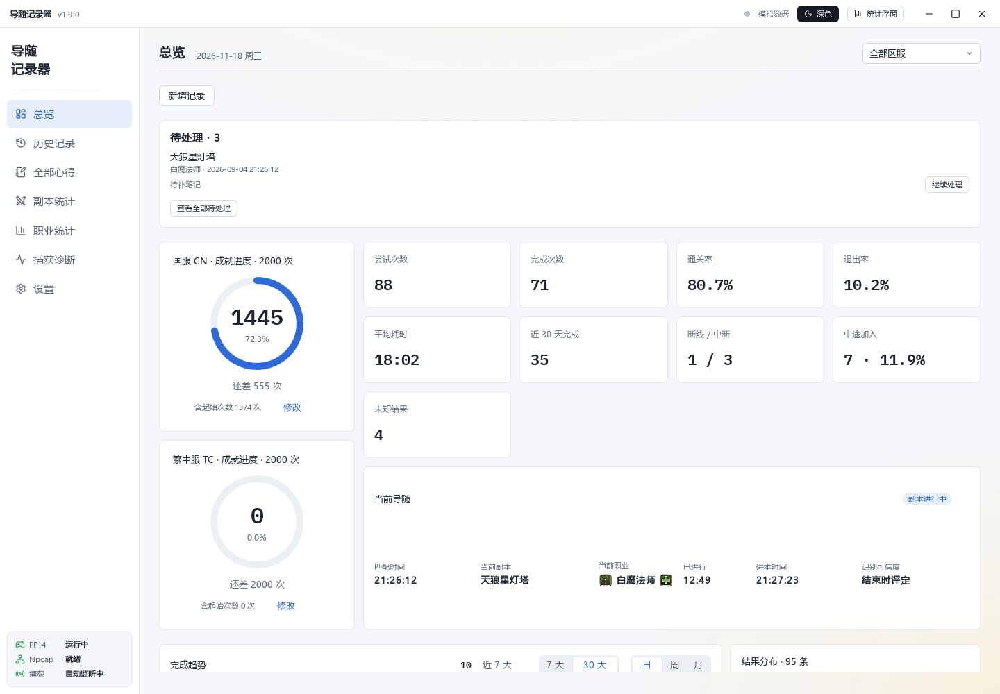
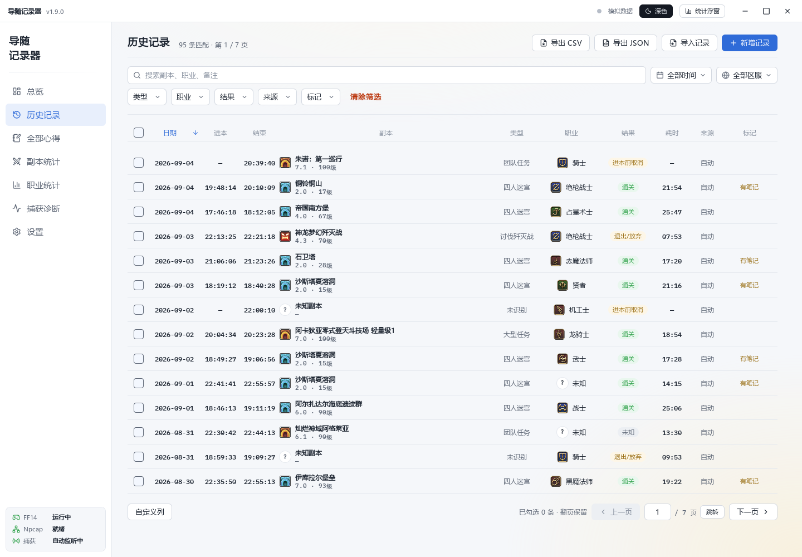
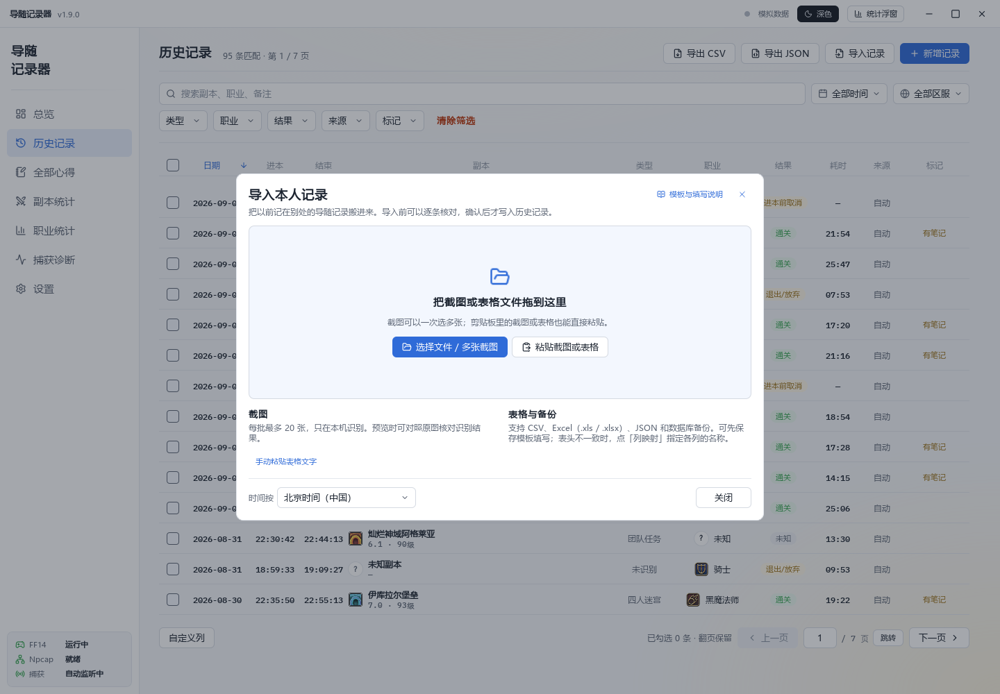

<h1 align="center">
  <br>
  导随记录器
</h1>

<p align="center">记录《最终幻想 14》指导者任务的 Windows 桌面应用</p>

<p align="center"><b>简体中文</b> · <a href="README.zh-TW.md">繁體中文</a> · <a href="README.en.md">English</a> · <a href="README.ja.md">日本語</a></p>

<p align="center">
  <a href="https://github.com/Harendotes-Tang/MentorRouletteRecorder/actions/workflows/ci.yml"></a>
  <a href="https://github.com/Harendotes-Tang/MentorRouletteRecorder/releases/latest"></a>
  <a href="LICENSE"></a>
  
</p>

<p align="center">
  <a href="https://github.com/Harendotes-Tang/MentorRouletteRecorder/releases/latest">正式版下载</a> ·
  <a href="https://gitcode.com/Harendotes-Tang/MentorRouletteRecorder/releases">GitCode 镜像</a> ·
  <a href="#快速开始">快速开始</a> ·
  <a href="#常见问题">常见问题</a>
</p>

导随记录器通过 Npcap 被动读取本机的游戏流量，记录指导者任务的匹配、进本、通关与离开，按区服和角色跟踪成就进度。
可补录、导入旧记录、统计副本与职业、整理心得。记录、截图识别与分享图片都保存在本机。

**当前源码版本为 `1.9.1-beta.1`（测试版，不代表该版本安装包已发布）。** 自动记录及登录角色识别目前支持**国服**。
繁中服和国际服支持手动管理记录。完整变更与升级注意事项见 [CHANGELOG.md](CHANGELOG.md)。

<p align="center"></p>

## 目录

- [功能](#功能)
- [区服支持](#区服支持)
- [系统要求与安装](#系统要求与安装)
- [快速开始](#快速开始)
- [导入历史记录与心得](#导入历史记录与心得)
- [离线截图 OCR](#离线截图-ocr)
- [工作原理](#工作原理)
- [隐私与网络边界](#隐私与网络边界)
- [常见问题](#常见问题)
- [从源码构建](#从源码构建)
- [参与贡献、安全与许可](#参与贡献安全与许可)

## 功能

- **自动记录与结果确认**。识别匹配、进本与离开，收到副本结算时自动记为通关。结果不明时，可在结果小窗或总览的「待处理」确认。
  识别到副本开始或剩余时间信号时，还会记录开局进入或中途加入。
- **区服与角色成就**。每个角色有独立的目标、起始次数和进度。「设置 → 成就」可添加或管理角色，历史记录可按角色筛选或批量调整归属。
  国服默认识别登录角色，已绑定的角色会自动切换。繁中服、国际服可在总览手动切换。
- **历史记录与统计**。日期预设、区服与角色筛选帮助查找记录。副本和职业统计的占比环可点选，支持筛选的分类可打开对应历史记录。
  完成趋势可以按日、周、月查看。导随统计浮窗支持自定义模块、迷你条和鼠标穿透。
- **补录、修订与导出**。手动补录和更正可保存图片与心得，保留修订历史；软删除后的记录可在保留期内恢复。
  CSV 与 JSON 依照历史列表当前排序导出。数据库默认每日自动备份，也可手动备份。
- **导入与离线识别**。支持表格、原生 JSON、软件数据库备份、粘贴及 dlog 截图。先预览和确认，再保存所选记录。
- **全部心得与分享图片**。可搜索正文、按日期筛选和切换排列顺序。分享时支持按日期排序或拖动手动排序，可保存长图或逐条 PNG。
- **语言、播报与托盘**。支持简体中文、繁體中文、English、日本語。可切换界面语言及系统语音，也可打开可选的在线播报。
  启用「开机启动」后，程序在系统托盘启动；打开主窗口后可查看更新说明。
- **捕获诊断与采证**。自动寻找承载游戏流量的网卡，可重新检测或查看诊断报告。新区服采证和角色识别采证各有独立向导。
  国服客户端更新后可通过本机或共享校准恢复记录。

<details>
<summary>历史记录与导入页面</summary>

<p align="center"></p>
<p align="center"></p>

</details>

## 区服支持

| 游戏区服 | 自动记录 | 记录、导入与成就 |
|---|---|---|
| 国服 `CN` | 内置经验证的 `2026.08.05` 协议档案。后续版本需要通过本机或共享校准 | 支持补录、导入导出、按角色统计。登录角色识别可在设置中关闭 |
| 繁中服 `TC` | 等待经验证的协议档案 | 有独立的繁中副本与随机任务目录，支持补录、导入导出和手动切换角色 |
| 国际服 `GLOBAL` | 等待经验证的协议档案 | 支持补录、导入导出和手动切换角色 |

游戏区服决定记录归属；界面语言可以独立切换。想协助验证自动记录，可按区服指南采证。
参见[繁中服测试指南](docs/traditional-chinese-server-testing.md)、[国际服测试指南](docs/global-server-testing.md)和[协议档案](protocol-profiles/README.md)。

## 系统要求与安装

| 项目 | 要求 |
|---|---|
| 操作系统 | Windows 10 64 位 1809（内部版本 17763）或更新，或 Windows 11。Windows 11 ARM 可用 x64 模拟，抓包尚未验证 |
| 自动记录 | 国服客户端及 [Npcap](https://npcap.com/)，需启用 *WinPcap API-compatible Mode* |
| 语音播报 | Windows N 版需要媒体功能包 |
| 运行库 | 安装包和 ZIP 已包含 .NET、Qt 与离线 OCR 运行时 |

1. 从 [GitHub 正式版](https://github.com/Harendotes-Tang/MentorRouletteRecorder/releases/latest)下载
   `MentorRecorder-<版本>-setup.exe`。也可从 [GitCode 镜像](https://gitcode.com/Harendotes-Tang/MentorRouletteRecorder/releases)下载安装器。
   GitHub 另提供解压即用的 `win-x64.zip`。历史版本和带 `-beta.N` 的测试版见 [GitHub Releases](https://github.com/Harendotes-Tang/MentorRouletteRecorder/releases)。
2. 可用 `Get-FileHash -Algorithm SHA256 -LiteralPath '下载文件路径'` 核对发布页的 `.sha256` 文件，然后运行安装器。
   向导默认选中 Windows 显示语言对应的选项。首次启动使用安装时选择的语言，从旧版升级时沿用原设置。
3. 安装器优先建议 `D:\MentorRecorder`，D 盘不满足条件时建议 `Program Files\MentorRecorder`。可选用空文件夹，升级可选原安装目录。
   安装文件由管理员管理，备注图片目录 `note-images` 可由普通用户写入。
4. Npcap 免费版由 Npcap 官网分发。缺少驱动时，安装器会下载并校验官方安装程序。保持其默认选项，尤其是 *WinPcap API-compatible Mode*。

**从旧版升级。** 1.9.1 将数据库升级为 schema 16。升级前请保留数据库备份；回退到旧版时使用升级前的备份。
1.8.0 及更早版本中没有区服的手动补录和导入记录会归入国服。已有区服的目标、起始次数和记录迁入该区服的原有档案。
数据库备份和记录导出均不包含备注图片，需另存 `note-images`。

## 快速开始

1. **填写起始次数。** 首次使用时录入游戏成就面板显示的安装前完成数。软件里已有计入进度的记录时，先从面板完成数中扣除这些通关。
   进度等于该角色的起始次数加上记录中计入进度的通关数。
2. **先启动记录器，再登录游戏。** 已登录时退回标题画面再登录即可。国服连接需要从建立时开始跟踪，游戏内传送不会重建这条连接。
3. **管理角色归属。** 只有一个档案且尚未登记任何角色时，国服首次识别到的角色会自动绑定。
   出现「发现了一个还没有登记的角色」时，可关联已有档案、登记新角色或选择「不统计这个角色」。待登记记录在绑定后归到所选档案。
   手动管理时先在「设置 → 成就」添加角色，换角色上线前在总览选择当前角色。
4. **参加指导者任务。** 收到通关结算时程序自动计入通关。离开前未收到结算时，可在独立小窗、浮窗提示或总览「待处理」确认。
5. **整理旧记录。** 在「历史 → 导入记录」导入自己过去的记录，可筛选并更正记录，也可在「全部心得」生成分享图片。

遇到问题或有功能建议时，可点主窗口左侧的「意见反馈」。选择「在 GitHub 反馈」会打开 [GitHub 反馈模板](https://github.com/Harendotes-Tang/MentorRouletteRecorder/issues/new/choose)。
选择「写邮件」会在默认邮件应用中打开一封寄给 `mentorrecorder@gmail.com` 的草稿，也可以复制邮箱后自行发送。

## 导入历史记录与心得

在「历史 → 导入记录」选择、拖入文件，或粘贴剪贴板里的表格和截图。

| 来源 | 支持范围 |
|---|---|
| 表格 | CSV、Excel `.xls` / `.xlsx`、粘贴表格文字；表头不同可指定列映射。模板含「区服」列 |
| 本软件记录 | 本软件导出的原生 JSON，以及 SQLite 数据库备份。导入会解析来源并生成预览，现有数据库不会被覆盖 |
| 截图 | dlog 手机卡片与网页记录列表，支持 PNG、JPG / JPEG、WebP、BMP，同批最多 20 张 |

1. 对照原文件或原图核对区服、副本、职业、日期、结果与心得，按来源选择时区。缺少结算结果的来源可能预填为「通关」，请选择实际结果。
2. 勾选要保存的条目并确认是自己的记录。「可能重复」项需要逐条核对。已确认的重复记录会跳过，冲突会保留本地记录。
3. 有计入进度的通关且当前档案的起始次数大于零时，按实际情况回答这些通关是否已计入起始次数。选择「已包含」会从起始次数扣除实际新增的
   有效通关数，最低扣到零。数据库备份和本软件导出的 JSON 默认「未包含」；表格、剪贴板、截图与其他 JSON 默认「已包含」。
4. 确认导入后核对保存结果。缺少实际进出本时间时保留未知，原站日期仍用于排序、日期筛选和趋势。
   确认为本人的导随通关可以计入成就，未知的进出本时间和耗时可稍后补充。

心得分享会按所选顺序保存 PNG，并报告每个文件的保存结果。生成的文件留在本机，由用户自行分享。

## 离线截图 OCR

随包提供 CPU 文字识别和小型职业图标分类器。用户无需安装 Python 或配置 GPU。程序使用 RapidOCR 3.10.0 与 ONNX Runtime 1.32.0，
在本机识别文字及其坐标，再结合表格布局和职业图标生成预览。低清晰度、陌生版式、符号和职业候选需人工核对。


2026-10-10 的软件开发回归用 5 张网页截图对照两种识别方案，共 50 条记录。RapidOCR 方案输出 50 条，原始副本名逐字一致 48 条，
副本目录辅助后一致 50 条。另一轮标点专项和回归覆盖 7 张截图、70 条记录；两轮均未测量心得全文准确率，也未用作跨机器验收。
完整计数和样本限制见[对照测试报告](docs/ocr-test-comparison-20261010.json)与[标点验证报告](docs/ocr-punctuation-test-20261010.json)。

模型版本、来源与许可见 [OCR 依赖清单](docs/licenses/ocr/dependency-manifest.json)和
[职业分类器元数据](src/Desktop/resources/models/job-icon-classifier.metadata.json)。可在本机打开[交互架构图](docs/ocr/local-ocr.html)。

## 工作原理

| 进程 | 职责 |
|---|---|
| `MentorRecorder.Collector.exe` | C# / .NET 8。通过 Machina.FFXIV 与 Npcap 采集、解码和识别事件，管理 SQLite 记录和本机命名管道 |
| `MentorRecorder.Desktop.exe` | C++20 / Qt Quick。提供主窗口与浮窗，启动并监控 Collector，通过本机命名管道读取状态或提交编辑 |
| `local-ai-ocr.exe` | 仅在导入截图时启动，在本机输出文字坐标并退出 |

协议档案按客户端版本描述匹配、换区、区域及职业消息。国服的通关结算、开始与剩余时间按报文内容识别。
档案不匹配时暂停自动记录，直到获得并确认适用的校准。已有真机证据覆盖国服匹配至离本的记录链路；
通关结算曾在 `2026.09.15` 的一种副本实测。其他副本的结算及中途加入仍需收集真机证据。
参见[架构](docs/architecture.md)、[状态机](docs/state-machine.md)与[协议档案格式](docs/protocol-profile-format.md)。

## 隐私与网络边界

- 采集通过 Npcap 被动进行，无注入、无游戏进程内存读取、无遥测、无账号。采集路径不向游戏发包，也不长期保存原始报文。
  为解压流量，Collector 在自身进程中加载游戏可执行文件的临时副本，停止监听后清理。被占用的副本会登记并在下次启动时处理。
- 国服角色识别用本机密钥对登录消息中的角色标识计算摘要。角色名由用户填写，软件不会从游戏读取角色名。记录导出和诊断报告均不带身份摘要。
- 记录、来源文件、OCR 文字、心得和图片在本机处理；桌面端与 Collector 通过本机命名管道通信。

| 网络功能 | 默认状态与行为 |
|---|---|
| 共享校准 | 默认开启。按需从固定 GitHub 仓库读取公开校准，失败时使用固定 GitCode 镜像。本机验证通过后才用于记录 |
| 在线语音 | 默认关闭。用户填入 Azure 或 OpenAI 兼容服务密钥后才可使用。只发送当前播报文字，密钥由 Windows 加密保存在本机 |
| 更新检查与下载 | 检查默认开启。先读 GitHub，失败时尝试 GitCode。用户点「下载安装包」后才下载同版安装器并核对 SHA-256，点「立即安装」后才启动安装器 |
| 安装 Npcap | 只有在安装软件时发现驱动缺失，安装器才会下载并核验官方 Npcap 安装程序 |

可在设置中关闭前三项，也可将 `MR_DISABLE_SHARED_FETCH`、`MR_DISABLE_ONLINE_SPEECH` 和 `MR_DISABLE_UPDATE_CHECK` 设为 `1` 后重启。
出站请求范围、诊断导出内容与自查方法见[隐私与网络边界文档](docs/privacy-boundary.md)。

## 常见问题

**游戏更新后如何恢复自动记录？**
按主窗口提示正常完成一次随机任务并核对本机校准结果。已有共享校准时，程序会根据本机流量验证结果决定何时启用。
发生协议变化或需要协助适配时，按[真机验证指南](docs/live-validation-guide.md)采集证据。

**游戏在运行，为什么没有产生记录？**
先确认区服支持和协议状态。已登录的国服客户端请退回标题画面再登录。使用加速器或 VPN 时，可在「捕获诊断」点「重新检测网卡」，
查看承载游戏连接的网卡与当前不记录的原因。更多检查见[捕获诊断](docs/capture-diagnostics.md)。

**需要一直以管理员身份运行吗？**
通常只在安装或更新时需要提升权限。如果 Npcap 安装时选择了仅管理员可用，需提升运行权限，或重新安装 Npcap 并取消该限制。

**记录和附件在哪里？**
正式构建默认为 `%LOCALAPPDATA%\MentorRecorder\mentor_recorder.db`，每日备份在 `backups\`，保留最近 14 份。
可使用 `MR_DATA_DIR` 更改数据目录。备注图片存于程序目录的 `note-images\`，可通过 `MR_NOTE_IMAGE_DIR` 更改。
卸载时默认保留数据，已附备注图片始终保留。

**繁中服或国际服想协助采证，从哪里开始？**
在「捕获诊断 → 工具」打开「新区服采证」，按向导选择区服与网卡、完成一场随机任务并保存说明。请按指南私下提交证据。
国服角色识别异常可用「角色识别采证」单独验证，该向导不会新增正式记录。

## 从源码构建

已验证的 Windows x64 工具链使用 .NET SDK 9.0.316（Collector 目标 .NET 8）、Qt 6.11.2、MinGW-w64 GCC 13.1、
CMake 3.24 或更新版本、Ninja、PowerShell 7 与 Python 3.12。完整验证需安装 `tools/requirements-ci.txt` 中的 Python 依赖，
并准备仓库要求版本的 cppcheck。安装器由 Inno Setup 6.7 或更新版本构建。

```powershell
python -m pip install -r tools/requirements-ci.txt
pwsh -NoProfile -File scripts/bootstrap.ps1
pwsh -NoProfile -File scripts/verify.ps1 -Configuration Release
pwsh -NoProfile -File scripts/package.ps1 -Configuration Release -Verify
```

工具链路径可通过 `MR_QT_PREFIX`、`MR_MINGW_BIN`、`MR_CMAKE_EXE`、`MR_NINJA_EXE`、`MR_CTEST_EXE`、`MR_CPPCHECK_EXE` 覆盖。
打包默认使用 `build-distribution\`，可用 `MR_BUILD_DIR` 指向其他独立目录。发布还需准备并核验固定的离线 OCR 运行目录和许可文件，
使用 `scripts/bootstrap-ocr.ps1 -RuntimeDirectory <运行目录>` 或将 `MR_OCR_DIR` 指向已核验的目录。
完整步骤见[构建与打包](docs/build-and-package.md)、[安全与质量门禁](docs/security-quality-gates.md)及[发布清单](docs/release-checklist.md)。

`verify.ps1 -TestFilter 'Category!=Soak'` 用于日常回归。正式发布执行完整验证和解包运行；实际安装升级、游戏内抓包和跨机器表现须另行验证。

| 路径 | 内容 |
|---|---|
| `src/Collector/` | 采集、协议、状态机、存储、IPC、导入、导出 |
| `src/Desktop/` | Qt Quick 界面、记录和档案操作、离线 OCR、心得分享 |
| `contracts/`、`protocol-profiles/` | IPC 契约、各区服协议档案与合成测试档案 |
| `data/`、`migrations/` | 副本、职业、随机任务目录、译名及 SQLite 迁移 |
| `installer/`、`scripts/` | 安装器、开发工具链、测试和发布脚本 |
| `tests/`、`tools/`、`docs/` | 测试与样本、开发工具、规格和验收文档 |

## 参与贡献、安全与许可

- 缺陷、改进建议和 PR 的提交方法见 [CONTRIBUTING.md](CONTRIBUTING.md)。协议档案的变更请附可审查的证据。
- 安全问题请按 [SECURITY.md](SECURITY.md) 私下报告。
- 本项目采用 [GPL-3.0-or-later](LICENSE)。构建链接 Machina.FFXIV 与 Qt Graphs，分发时须遵守相应的 GPL 条款。
  第三方组件和许可见 [THIRD_PARTY_NOTICES.md](THIRD_PARTY_NOTICES.md)。

### 致谢

- 感谢辛弥山@龙巢神殿参与项目。
- [Machina.FFXIV](https://github.com/ravahn/machina) 提供流量捕获与解码，[Npcap](https://npcap.com/) 提供抓包驱动，
  [Qt](https://www.qt.io/) 提供桌面界面框架，[Lucide](https://lucide.dev/) 提供操作图标。
- SQUARE ENIX 的职业、职能、副本图标及游戏译名根据
  [FINAL FANTASY XIV Materials Usage License](https://support.na.square-enix.com/rule.php?id=5382&tag=authc)用于非商业分发。
  来源与本机替换方式见[游戏图标许可说明](src/Desktop/resources/icons/LICENSE-NOTE.md)。

### 免责声明

FINAL FANTASY XIV 是 SQUARE ENIX CO., LTD. 的商标。本项目独立开发，未获得 SQUARE ENIX 的授权、认可或赞助。
抓包会读取本机网卡流量，请确认所在环境允许此类操作，账号使用风险由用户自行判断。
