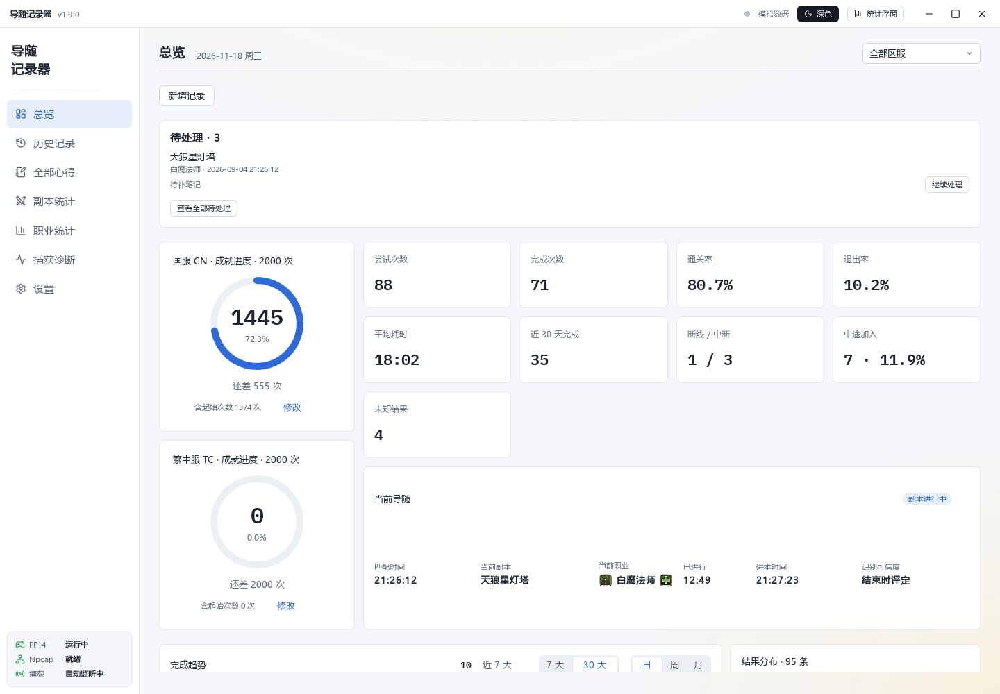
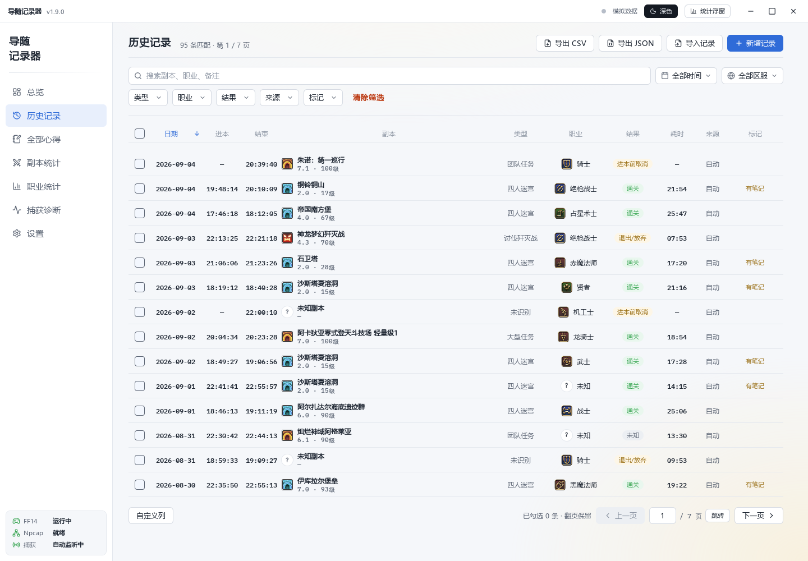
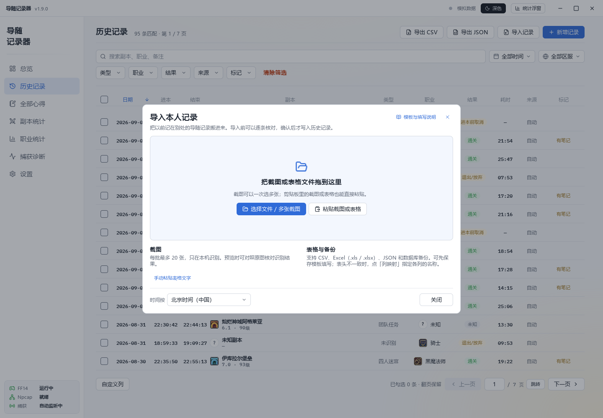

<h1 align="center">
  <br>
  導隨記錄器
</h1>

<p align="center">記錄《FINAL FANTASY XIV》指導者任務的 Windows 桌面應用程式</p>

<p align="center"><a href="README.md">简体中文</a> · <b>繁體中文</b> · <a href="README.en.md">English</a> · <a href="README.ja.md">日本語</a></p>

<p align="center">
  <a href="https://github.com/Harendotes-Tang/MentorRouletteRecorder/actions/workflows/ci.yml"></a>
  <a href="https://github.com/Harendotes-Tang/MentorRouletteRecorder/releases/latest"></a>
  <a href="LICENSE"></a>
  
</p>

<p align="center">
  <a href="https://github.com/Harendotes-Tang/MentorRouletteRecorder/releases/latest">正式版下載</a> ·
  <a href="https://gitcode.com/Harendotes-Tang/MentorRouletteRecorder/releases">GitCode 鏡像</a> ·
  <a href="#快速開始">快速開始</a> ·
  <a href="#常見問題">常見問題</a>
</p>

導隨記錄器透過 Npcap 被動讀取本機的遊戲流量，記錄指導者任務的配對、進本、通關與離開，依區服和角色追蹤成就進度。
可補錄、匯入舊記錄、統計副本與職業、整理心得。記錄、截圖辨識與分享圖片都儲存在本機。

**目前的原始碼版本記錄在 [Directory.Build.props](Directory.Build.props)，不代表該版本的安裝程式已發布。** 自動記錄及登入角色識別目前支援**國服**與**國際服**（國際服客戶端 2026.11.03）。
繁中服目前只能手動管理記錄。完整變更與升級注意事項請見 [CHANGELOG.md](CHANGELOG.md)（簡體中文）。

<p align="center"></p>

## 目錄

- [功能](#功能)
- [區服支援](#區服支援)
- [系統需求與安裝](#系統需求與安裝)
- [快速開始](#快速開始)
- [匯入歷史記錄與心得](#匯入歷史記錄與心得)
- [副本提醒與導隨巨集](#副本提醒與導隨巨集)
- [離線截圖 OCR](#離線截圖-ocr)
- [運作原理](#運作原理)
- [隱私與網路邊界](#隱私與網路邊界)
- [常見問題](#常見問題)
- [從原始碼建置](#從原始碼建置)
- [參與貢獻、安全性與授權](#參與貢獻安全性與授權)

## 功能

- **自動記錄與結果確認**。辨識配對、進本與離開，收到副本結算時自動記為通關。結果不明時，可在結果小視窗或總覽的「待處理」確認。
  辨識到副本開始或剩餘時間訊號時，還會記錄開局進入或中途加入。
- **區服與角色成就**。每個角色有獨立的目標、起始次數和進度。「設定 → 成就」可新增或管理角色，歷史記錄可依角色篩選或批次調整歸屬。
  國服與國際服預設識別登入角色，已綁定的角色會自動切換。繁中服可在總覽手動切換。
- **歷史記錄與統計**。日期預設、區服與角色篩選可協助尋找記錄。副本和職業統計的占比環可點選，支援篩選的分類可開啟對應的歷史記錄。
  完成趨勢可以依日、週、月檢視。導隨統計浮窗支援自訂模組、迷你條和滑鼠穿透。
- **補錄、修訂與匯出**。手動補錄和更正可儲存圖片與心得，保留修訂歷程；軟刪除後的記錄可在保留期限內恢復。
  CSV 與 JSON 依照歷史清單目前的排序匯出。資料庫預設每日自動備份，也可手動備份。
- **匯入與離線辨識**。支援表格、原生 JSON、軟體資料庫備份、貼上及 dlog 截圖。先預覽和確認，再儲存所選記錄。
- **全部心得與分享圖片**。可搜尋內文、依日期篩選和切換排列順序。分享時支援依日期排序或拖曳手動排序，可儲存長圖或逐則 PNG。
- **語言、語音播報與系統匣**。支援简体中文、繁體中文、English、日本語。可切換介面語言及系統語音，也可開啟選用的線上播報。
  啟用「開機啟動」後，程式會在系統匣啟動；開啟主視窗後可檢視更新說明。
- **副本提醒與導隨巨集**。為目前副本準備本機提醒與常用巨集，可選擇瀏覽其他玩家投稿的公共共享庫（預設不連線），詳見[副本提醒與導隨巨集](#副本提醒與導隨巨集)。
- **擷取診斷與採證**。自動尋找承載遊戲流量的網路卡，可重新偵測或檢視診斷報告。新區服採證和角色識別採證各有獨立的精靈。
  國服與國際服用戶端更新後，可透過本機或共享校準恢復記錄。國際服的本機校準尚未經歷真實的版本更新。

<details>
<summary>歷史記錄與匯入頁面</summary>

<p align="center"></p>
<p align="center"></p>

</details>

## 區服支援

| 遊戲區服 | 自動記錄 | 記錄、匯入與成就 |
|---|---|---|
| 國服 `CN` | 內建經過驗證的 `2026.08.05` 協定檔案。後續版本需要透過本機或共享校準 | 支援補錄、匯入匯出、依角色統計。登入角色識別可在設定中關閉 |
| 繁中服 `TC` | 等待經過驗證的協定檔案 | 有獨立的繁中副本與隨機任務目錄，支援補錄、匯入匯出和手動切換角色 |
| 國際服 `GLOBAL` | 內建經過驗證的 `2026.11.03` 協定檔案。後續版本需要透過本機或共享校準，尚未經歷真實的版本更新 | 支援補錄、匯入匯出、依角色統計。登入角色識別可在設定中關閉 |

遊戲區服決定記錄的歸屬；介面語言可以獨立切換。若想協助驗證自動記錄，可依各區服的指南採證。
請參閱[繁中服測試指南](docs/traditional-chinese-server-testing.md)（繁體中文）、[國際服測試指南](docs/global-server-testing.md)（英文）和[協定檔案](protocol-profiles/README.md)（簡體中文）。

## 系統需求與安裝

| 項目 | 需求 |
|---|---|
| 作業系統 | Windows 10 64 位元 1809（組建 17763）或更新版本，或 Windows 11。Windows 11 ARM 可透過 x64 模擬執行，封包擷取尚未驗證 |
| 自動記錄 | 國服或國際服用戶端及 [Npcap](https://npcap.com/)，需啟用 *WinPcap API-compatible Mode* |
| 語音播報 | Windows N 版需要媒體功能套件 |
| 執行階段程式庫 | 安裝程式和 ZIP 已包含 .NET、Qt 與離線 OCR 執行階段 |

1. 從 [GitHub 正式版](https://github.com/Harendotes-Tang/MentorRouletteRecorder/releases/latest)下載
   `MentorRecorder-<版本>-setup.exe`。也可從 [GitCode 鏡像](https://gitcode.com/Harendotes-Tang/MentorRouletteRecorder/releases)下載安裝程式。
   GitHub 另提供解壓縮即可使用的 `win-x64.zip`。歷史版本和帶有 `-beta.N` 的測試版請見 [GitHub Releases](https://github.com/Harendotes-Tang/MentorRouletteRecorder/releases)。
2. 可用 `Get-FileHash -Algorithm SHA256 -LiteralPath '下載檔案路徑'` 核對發布頁面的 `.sha256` 檔案，再執行安裝程式。
   精靈預設選取 Windows 顯示語言對應的選項。首次啟動使用安裝時選擇的語言，從舊版升級時沿用原本的設定。
3. 安裝程式優先建議 `D:\MentorRecorder`，D 磁碟不符合條件時建議 `Program Files\MentorRecorder`。可選用空資料夾，升級時可選原安裝目錄。
   安裝檔案由系統管理員管理，備註圖片目錄 `note-images` 可由一般使用者寫入。
4. Npcap 免費版由 Npcap 官網發行。缺少驅動程式時，安裝程式會下載並驗證官方安裝程式。請保持其預設選項，尤其是 *WinPcap API-compatible Mode*。

**從舊版升級。** 1.9.0 會將資料庫升級為 schema 15，1.9.1 升級為 schema 17，1.10.0 測試版升級為 schema 18（目前的原始碼為 schema 20）。升級前請保留資料庫備份；退回舊版時請使用升級前的備份。
1.8.0 及更早版本中沒有區服的手動補錄和匯入記錄會歸入國服。已有區服的目標、起始次數和記錄會遷入該區服原有的檔案。
資料庫備份和記錄匯出均不包含備註圖片，需另行保存 `note-images`。

## 快速開始

1. **填寫起始次數。** 首次使用時，輸入遊戲成就面板顯示的安裝前完成次數。軟體中已有計入進度的記錄時，先從面板的完成次數中扣除這些通關。
   進度等於該角色的起始次數加上記錄中計入進度的通關次數。
2. **先啟動記錄器，再登入遊戲。** 若已登入，退回標題畫面再登入即可。國服連線需要從建立時開始追蹤，遊戲內傳送不會重建這條連線。
3. **管理角色歸屬。** 只有一個檔案且尚未登記任何角色時，國服或國際服首次識別到的角色會自動綁定。
   出現「發現了一個還沒有登記的角色」時，可關聯現有檔案、登記新角色或選擇「不統計這個角色」。待登記的記錄在綁定後會歸到所選檔案。
   手動管理時，先在「設定 → 成就」新增角色，換角色上線前在總覽選擇目前角色。
4. **參加指導者任務。** 收到通關結算時，程式會自動計入通關。離開前未收到結算時，可在獨立小視窗、浮窗提示或總覽的「待處理」確認。
5. **整理舊記錄。** 在「歷史 → 匯入記錄」匯入自己過去的記錄，可篩選並更正記錄，也可在「全部心得」產生分享圖片。

遇到問題或有功能建議時，可點主視窗左側的「意見回饋」。選擇「在 GitHub 回饋」會開啟 [GitHub 回饋範本](https://github.com/Harendotes-Tang/MentorRouletteRecorder/issues/new/choose)。
選擇「寫電子郵件」會在預設郵件應用程式中開啟一封寄給 `mentorrecorder@gmail.com` 的草稿，也可以複製電子郵件地址後自行寄送。

## 匯入歷史記錄與心得

在「歷史 → 匯入記錄」選擇、拖曳檔案，或貼上剪貼簿中的表格和截圖。

| 來源 | 支援範圍 |
|---|---|
| 表格 | CSV、Excel `.xls` / `.xlsx`、貼上的表格文字；表頭不同時可指定欄位對應。範本含「區服」欄 |
| 本軟體記錄 | 本軟體匯出的原生 JSON，以及 SQLite 資料庫備份。匯入時會解析來源並產生預覽，不會覆寫現有資料庫 |
| 截圖 | dlog 手機卡片與網頁記錄清單，支援 PNG、JPG / JPEG、WebP、BMP，同一批最多 20 張 |

1. 對照原始檔案或原圖核對區服、副本、職業、日期、結果與心得，依來源選擇時區。缺少結算結果的來源可能預先填為「通關」，請選擇實際結果。
2. 勾選要儲存的項目，並確認是自己的記錄。「可能重複」的項目需要逐筆核對。已確認的重複記錄會略過，發生衝突時會保留本機記錄。
3. 有計入進度的通關且目前檔案的起始次數大於零時，請依實際情況回答這些通關是否已計入起始次數。選擇「已包含」會從起始次數扣除實際新增的
   有效通關次數，最低扣到零。資料庫備份和本軟體匯出的 JSON 預設為「未包含」；表格、剪貼簿、截圖與其他 JSON 預設為「已包含」。
4. 確認匯入後核對儲存結果。缺少實際進出本時間時保留為未知，原網站的日期仍用於排序、日期篩選和趨勢。
   確認為本人的導隨通關可以計入成就，未知的進出本時間和耗時可稍後補充。

心得分享會依所選順序儲存 PNG，並回報每個檔案的儲存結果。產生的檔案留在本機，由使用者自行分享。

## 副本提醒與導隨巨集

從主頁的目前副本區域開啟本機提醒、常用巨集或公共共享庫。提醒和巨集可離線編輯、排序、收藏、複製和交換。
公共共享庫預設不連線，在「提醒與巨集」中開啟「允許公共庫連線」後才讀取；瀏覽不需要帳號。投稿時軟體複製所選內容並開啟公開倉庫的投稿頁，
由你在瀏覽器中以自己的 GitHub 帳號提交。攻略連結由瀏覽器開啟：中文介面使用新大陆见闻录（ff14.org），英語與日語介面使用 Console Games Wiki，
提供攻略目錄與已對應的副本頁面。詳見[使用與維護說明](docs/duty-community.md)（簡體中文）。

## 離線截圖 OCR

隨附 CPU 文字辨識和小型職業圖示分類器。使用者無需安裝 Python 或設定 GPU。程式使用 RapidOCR 3.10.0 與 ONNX Runtime 1.32.0，
在本機辨識文字及其座標，再結合表格版面和職業圖示產生預覽。低解析度、陌生版面、符號和職業候選需人工核對。


2026-10-10 的軟體開發迴歸測試用 5 張網頁截圖對照兩種辨識方案，共 50 筆記錄。RapidOCR 方案輸出 50 筆，原始副本名稱逐字一致 48 筆，
經副本目錄輔助後一致 50 筆。另一輪標點專項和迴歸測試涵蓋 7 張截圖、70 筆記錄；兩輪均未測量心得全文的準確率，也未用作跨機器驗收。
完整計數和樣本限制請見[對照測試報告](docs/ocr-test-comparison-20261010.json)（英文）與[標點驗證報告](docs/ocr-punctuation-test-20261010.json)（英文）。

模型版本、來源與授權請見 [OCR 相依元件清單](docs/licenses/ocr/dependency-manifest.json)（英文）和
[職業分類器中繼資料](src/Desktop/resources/models/job-icon-classifier.metadata.json)（英文）。可在本機開啟[互動架構圖](docs/ocr/local-ocr.html)（簡體中文）。

## 運作原理

| 處理程序 | 職責 |
|---|---|
| `MentorRecorder.Collector.exe` | C# / .NET 8。透過 Machina.FFXIV 與 Npcap 擷取、解碼和辨識事件，管理 SQLite 記錄和本機具名管道 |
| `MentorRecorder.Desktop.exe` | C++20 / Qt Quick。提供主視窗與浮窗，啟動並監控 Collector，透過本機具名管道讀取狀態或提交編輯 |
| `local-ai-ocr.exe` | 僅在匯入截圖時啟動，在本機輸出文字座標後結束 |

協定檔案依用戶端版本描述配對、換區、區域及職業訊息。國服與國際服的通關結算、開始與剩餘時間依封包內容辨識。
檔案不符時暫停自動記錄，直到取得並確認適用的校準。已有實機證據涵蓋國服從配對到離本的記錄流程；
通關結算曾在 `2026.09.15` 的一種副本實測。其他副本的結算及中途加入仍需收集實機證據。
請參閱[架構](docs/architecture.md)（簡體中文）、[狀態機](docs/state-machine.md)（簡體中文）與[協定檔案格式](docs/protocol-profile-format.md)（簡體中文）。

## 隱私與網路邊界

- 擷取透過 Npcap 被動進行，無注入、不讀取遊戲處理程序記憶體、無遙測，本軟體也沒有自己的帳號體系。擷取路徑不向遊戲傳送封包，也不長期保存原始封包。
  為解壓縮流量，Collector 會在自身處理程序中載入遊戲執行檔的暫存副本，停止監聽後清除。被占用的副本會登記，並在下次啟動時處理。
- 新區服採證時，若目前的遊戲版本還沒有現成的解壓縮適配，Collector 會讀取本機的遊戲主程式檔案查找相關位置，把查找結果和該檔案的校驗值寫入本機日誌；找不全、或找到後仍解不出資料時，日誌還會記下幾小段遊戲主程式的指令位元組。日誌不含封包和個人資訊，只保存在本機，是否回傳給維護者由測試者決定，詳見[隱私與網路邊界文件](docs/privacy-boundary.md) §4、§5。
- 國服與國際服的角色識別使用本機金鑰對登入訊息中的角色識別碼計算摘要。角色名稱由使用者填寫，軟體不會從遊戲讀取角色名稱。記錄匯出和診斷報告均不含身分摘要。
- 記錄、來源檔案、OCR 文字、心得和圖片均在本機處理；桌面端與 Collector 透過本機具名管道通訊。

| 網路功能 | 預設狀態與行為 |
|---|---|
| 共享校準 | 預設開啟。依需要從固定的 GitHub 存放庫讀取公開校準，失敗時使用固定的 GitCode 鏡像。通過本機驗證後才用於記錄 |
| 線上語音 | 預設關閉。使用者填入 Azure 或 OpenAI 相容服務的金鑰後才可使用。只傳送目前播報的文字，金鑰由 Windows 加密保存在本機 |
| 更新檢查與下載 | 檢查預設開啟。先讀取 GitHub，失敗時嘗試 GitCode。使用者點「下載安裝程式」後才下載同版本的安裝程式並核對 SHA-256（GitHub 下載過慢時先詢問是否改從 GitCode 下載），點「立即安裝」後才啟動安裝程式 |
| 提醒與巨集的公共共享庫 | 預設關閉。在「提醒與巨集」中開啟「允許公共庫連線」後，只在開啟公共共享庫或重新整理時從固定 GitHub 倉庫讀取公開內容，失敗時使用固定 GitCode 鏡像，不傳送本機內容。點擊查詢「投稿進度」時只向 GitHub 傳送所填的 Issue 編號。投稿在你的瀏覽器中進行，本軟體不保存 GitHub 登入資訊 |
| 安裝 Npcap | 只有在安裝軟體時發現缺少驅動程式，安裝程式才會下載並驗證官方 Npcap 安裝程式 |

可在設定中關閉前四項（投稿進度的查詢只在點擊時發生），也可將 `MR_DISABLE_SHARED_FETCH`、`MR_DISABLE_ONLINE_SPEECH`、`MR_DISABLE_UPDATE_CHECK` 和 `MR_DISABLE_DUTY_COMMUNITY` 設為 `1` 後重新啟動。
對外連線請求的範圍、診斷匯出內容與自行檢查方法請見[隱私與網路邊界文件](docs/privacy-boundary.md)（簡體中文）。

## 常見問題

**遊戲更新後如何恢復自動記錄？**
依主視窗提示正常完成一次隨機任務，並核對本機校準結果。已有共享校準時，程式會根據本機流量的驗證結果決定何時啟用。
發生協定變更或需要協助適配時，請依[實機驗證指南](docs/live-validation-guide.md)（簡體中文）收集證據。

**遊戲正在執行，為什麼沒有產生記錄？**
請先確認區服支援和協定狀態。已登入的國服用戶端請退回標題畫面再登入。使用加速器或 VPN 時，可在「擷取診斷」點「重新偵測網路卡」，
檢視承載遊戲連線的網路卡與目前不記錄的原因。更多檢查項目請見[擷取診斷](docs/capture-diagnostics.md)（簡體中文）。

**需要一直以系統管理員身分執行嗎？**
通常只在安裝或更新時需要提升權限。如果安裝 Npcap 時選擇了僅限系統管理員使用，需提升執行權限，或重新安裝 Npcap 並取消該限制。

**記錄和附件在哪裡？**
正式組建預設為 `%LOCALAPPDATA%\MentorRecorder\mentor_recorder.db`，每日備份在 `backups\`，保留最近 14 份。
可使用 `MR_DATA_DIR` 變更資料目錄。備註圖片存放於程式目錄的 `note-images\`，可透過 `MR_NOTE_IMAGE_DIR` 變更。
解除安裝時預設保留資料，已附加的備註圖片一律保留。

**繁中服或國際服想協助採證，從哪裡開始？**
在「擷取診斷 → 工具」開啟「新區服採證」，依精靈選擇區服與網路卡、完成一場隨機任務並儲存說明。請依指南私下提交證據。
國服或國際服角色識別異常時，可用「角色識別採證」單獨驗證，該精靈不會新增正式記錄。

## 從原始碼建置

已驗證的 Windows x64 工具鏈使用 .NET SDK 9.0.316（Collector 目標為 .NET 8）、Qt 6.11.2、MinGW-w64 GCC 13.1、
CMake 3.24 或更新版本、Ninja、PowerShell 7 與 Python 3.12。完整驗證需安裝 `tools/requirements-ci.txt` 中的 Python 相依套件，
並準備存放庫要求版本的 cppcheck。安裝程式由 Inno Setup 6.7 或更新版本建置。

```powershell
python -m pip install -r tools/requirements-ci.txt
pwsh -NoProfile -File scripts/bootstrap.ps1
pwsh -NoProfile -File scripts/verify.ps1 -Configuration Release
pwsh -NoProfile -File scripts/package.ps1 -Configuration Release -Verify
```

工具鏈路徑可透過 `MR_QT_PREFIX`、`MR_MINGW_BIN`、`MR_CMAKE_EXE`、`MR_NINJA_EXE`、`MR_CTEST_EXE`、`MR_CPPCHECK_EXE` 覆寫。
封裝預設使用 `build-distribution\`，可用 `MR_BUILD_DIR` 指向其他獨立目錄。發布時還需準備並驗證固定的離線 OCR 執行目錄和授權檔案，
請使用 `scripts/bootstrap-ocr.ps1 -RuntimeDirectory <執行目錄>`，或將 `MR_OCR_DIR` 指向已驗證的目錄。
完整步驟請見[建置與封裝](docs/build-and-package.md)（簡體中文）、[安全與品質門檻](docs/security-quality-gates.md)（簡體中文）及[發布檢查清單](docs/release-checklist.md)（簡體中文）。

`verify.ps1 -TestFilter 'Category!=Soak'` 用於日常迴歸測試。正式發布會執行完整驗證和解封裝後執行；實際安裝升級、遊戲內封包擷取和跨機器表現須另行驗證。

| 路徑 | 內容 |
|---|---|
| `src/Collector/` | 擷取、協定、狀態機、儲存、IPC、匯入、匯出 |
| `src/Desktop/` | Qt Quick 介面、記錄和檔案操作、離線 OCR、心得分享 |
| `contracts/`、`protocol-profiles/` | IPC 契約、各區服協定檔案與合成測試檔案 |
| `data/`、`migrations/` | 副本、職業、隨機任務目錄、譯名及 SQLite 遷移 |
| `installer/`、`scripts/` | 安裝程式、開發工具鏈、測試和發布指令碼 |
| `tests/`、`tools/`、`docs/` | 測試與樣本、開發工具、規格和驗收文件 |

## 參與貢獻、安全性與授權

- 缺陷、改進建議和 PR 的提交方式請見 [CONTRIBUTING.md](CONTRIBUTING.md)（簡體中文）。變更協定檔案時，請附上可供審查的證據。
- 安全性問題請依 [SECURITY.md](SECURITY.md)（簡體中文）私下回報。
- 本專案採用 [GPL-3.0-or-later](LICENSE)（英文）授權。建置時連結 Machina.FFXIV 與 Qt Graphs，發行時須遵守相應的 GPL 條款。
  第三方元件和授權請見 [THIRD_PARTY_NOTICES.md](THIRD_PARTY_NOTICES.md)（簡體中文）。

### 致謝

- 感謝辛彌山@龍巢神殿參與專案。
- 感謝シーヴ協助國際服的採證測試。
- [Machina.FFXIV](https://github.com/ravahn/machina) 提供流量擷取與解碼，[Npcap](https://npcap.com/) 提供封包擷取驅動程式，
  [Qt](https://www.qt.io/) 提供桌面介面框架，[Lucide](https://lucide.dev/) 提供操作圖示。
- SQUARE ENIX 的職業、職能、副本圖示及遊戲譯名依據
  [FINAL FANTASY XIV Materials Usage License](https://support.na.square-enix.com/rule.php?id=5382&tag=authc)用於非商業發行。
  來源與本機替換方式請見[遊戲圖示授權說明](src/Desktop/resources/icons/LICENSE-NOTE.md)（簡體中文）。

### 免責聲明

FINAL FANTASY XIV 是 SQUARE ENIX CO., LTD. 的商標。本專案獨立開發，未獲得 SQUARE ENIX 的授權、認可或贊助。
封包擷取會讀取本機網路卡的流量，請確認所在環境允許此類操作，帳號使用風險由使用者自行判斷。
